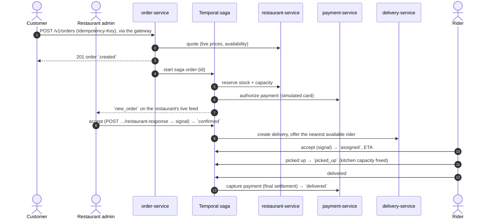

# SmartFoodOps

A microservices-based food ordering and delivery platform (Part A of the SmartFoodOps
assignment — core platform + distributed systems; the GenAI layer is Part B, built later
on top of this).

See [docs/PRD.md](docs/PRD.md) for requirements and feature → deliverable traceability,
[docs/architecture.md](docs/architecture.md) for the full system design,
[docs/technical-documentation.md](docs/technical-documentation.md) for the reasoning
behind each decision, [docs/diagrams.md](docs/diagrams.md) for the component diagram, order-lifecycle
sequence diagrams and per-service ER diagrams, and [docs/PROGRESS.md](docs/PROGRESS.md)
for current build status — **read PROGRESS.md first** when picking this project back up in
a new session.

## Architecture at a glance

```
                               clients (REST + SSE)
                                        │
                               ┌────────▼────────┐  routing, JWT + deny-list check,
                               │   api-gateway   │  rate limiting, CORS, Swagger
                               └────────┬────────┘  index, SSE streaming proxy
       ┌───────────────┬────────────────┼────────────────┬─────────────────┐
┌──────▼──────┐ ┌──────▼──────┐ ┌───────▼───────┐ ┌──────▼──────┐ ┌────────▼───────┐
│ user-service│ │ restaurant- │ │ order-service │ │  delivery-  │ │tracking-service│
│             │ │   service   │ │ + saga        │ │   service   │ │ SSE, no DB     │
└─────────────┘ └──────▲──────┘ └───────┬───────┘ └──────▲──────┘ └────────▲───────┘
                       │                │ start          │                 │
                       │       ┌────────▼────────┐       │                 │ Pub/Sub +
                       └───────┤ Temporal server ├───────┘                 │ state keys
                    activities └────────┬────────┘ activities      ┌───────┴───────┐
                                        │ activities               │     Redis     │
                                ┌───────▼───────┐                  └───────▲───────┘
                                │payment-service│        statuses, ETAs, offers: Kafka → tracking;
                                └───────────────┘        rider location: delivery-service

   The gateway also routes to payment-, notification- and analytics-service (not drawn).
   Each service has its own database and runs its own Temporal worker on its own task
   queue: the saga in order-service schedules activities next to the data they change.
   Domain events leave each service through its outbox (below).
```

Events, notifications and analytics:

```
  order- / payment- / delivery-service
  business write + outbox row (one transaction)
            │
            ▼
  order-, payment-, delivery-worker ──► Kafka ──┬──► notification-service ──► RabbitMQ ──► notification-worker
  (Celery beat relay, every 1s)                 │    (consumer)                            (in-app / email / SMS,
                                                │                                           retries, then failed)
                                                ├──► analytics-service ──► MongoDB (metrics read model)
                                                │
                                                └──► tracking-service ──► Redis (live-feed state + Pub/Sub → SSE)

  Every process: traces → Jaeger, metrics → Prometheus, logs → Loki; all three in Grafana.
```

Every service owns its own database — no service reads another's DB directly.
Cross-service contact happens only via sync REST (order → restaurant for the quote), the
Temporal order saga, Redis Pub/Sub for live tracking (order status fed from Kafka), Kafka domain events, or Celery
background jobs. Full rationale in [docs/architecture.md](docs/architecture.md);
component, sequence and ER diagrams in [docs/diagrams.md](docs/diagrams.md).

### Order + delivery flow

As built. The order is created synchronously; everything after runs in the Temporal saga,
and the customer and restaurant watch it on live SSE feeds.



Failures and cancellations before pickup run the saga's compensations (void payment,
release stock, free the rider); diagrams for reassignment, cancellation and refunds are in
[docs/diagrams.md](docs/diagrams.md).

## Core workflows

Full state transitions, compensation matrix and consistency model:
[docs/technical-documentation.md](docs/technical-documentation.md#order-lifecycle).

- **Order lifecycle**: `created → awaiting_restaurant_acceptance → confirmed → assigned →
  picked_up → delivered`, plus `rejected`/`cancelled`. Creation validates and prices
  server-side and needs an `Idempotency-Key`; a Temporal saga in `order-service` drives
  every later transition, with a 5-minute restaurant decision timeout.
- **Delivery lifecycle**: rider registration, admin vetting, availability and location
  pings → nearest available rider offered (Redis GEO), 60s to accept → reassignment on
  decline, expiry or drop-out → pickup → delivery, with ETAs.
- **Live tracking**: customers follow their order, restaurants get new orders and riders
  get offers over SSE (`/v1/tracking/...`), served by `tracking-service`. Order and
  delivery updates come from Kafka (so none is lost), and Redis Pub/Sub delivers them to
  whichever replica holds the stream.
- **Cancellation/refund**: cancel until pickup — the saga compensates for whatever had
  happened (release stock, void payment, free the rider). After delivery a system admin
  can refund all or part of an order.
- **Events, notifications, analytics**: every state change writes an event to its
  service's outbox in the same transaction; relay workers publish it to Kafka.
  notification-service tells the customer, restaurant admin and rider (in-app, plus
  simulated email/SMS sent by a Celery worker with retries), and analytics-service
  computes the nine Part A metrics (`/v1/analytics/...`). Consumers are idempotent, and a
  message they can't process goes to a dead-letter topic.
- **Observability**: one trace per order across every service in Jaeger; Prometheus
  metrics, 4 Grafana dashboards and 7 alerts; all logs searchable in Grafana (Loki), each
  line linked to its trace.

## Tech stack

Python, FastAPI, PostgreSQL (database-per-service), MongoDB (rider location history,
analytics), Redis (cache, deny-list, rate limits, rider GEO pool, Pub/Sub for live
tracking), Temporal (order saga), Kafka + Schema Registry (domain events, JSON Schema),
Celery + RabbitMQ (outbox relay, notification sending), OpenTelemetry + Jaeger (traces),
Prometheus + Grafana (metrics, dashboards, alerts), Loki + Grafana Alloy (logs), Docker
Compose. Dependency management via `uv` workspaces. Full library-level choices
(ORM, JWT, Kafka client, etc.) with rationale in
[docs/technical-documentation.md](docs/technical-documentation.md#library--tooling-choices).

## Local setup

Requires Docker + Docker Compose and [uv](https://docs.astral.sh/uv/). uv is needed even if
you only run the stack: it runs the script that creates the token-signing key (step 1), as
well as the tests and the seed script.

1. For each service under `services/`, copy its `env.example` to `.env` (dummy local
   values are already fine for dev — see
   [architecture.md#conventions](docs/architecture.md#conventions) for why these are
   named `env.example` rather than the more common `.env.example`):

   ```bash
   for d in services/*/; do [ -f "$d/env.example" ] && cp "$d/env.example" "$d/.env"; done
   ```

   This overwrites any `.env` you already have. On an existing checkout, copy only the
   files that are missing, or add new lines from `env.example` by hand.

   Then create the key that signs access tokens (once; it's git-ignored and only
   `user-service` gets it — see
   [architecture.md#access-token-signing](docs/architecture.md#access-token-signing)).
   `docker compose` won't start without it:

   ```bash
   uv run python scripts/gen_jwt_key.py
   ```

   **Upgrading an existing checkout** (`.env` files and a key from before key rotation):
   - Run the script again. It keeps your key ("already exists; not overwriting it") and
     only adds the empty `secrets/jwt_additional_public_keys.pem` that compose now mounts.
   - Add this line to `services/user-service/.env`; without it the stack runs, but a key
     rotation publishes nothing:

     ```
     JWT_ADDITIONAL_PUBLIC_KEYS_FILE=/run/secrets/jwt_additional_public_keys
     ```

   - Any leftover `JWT_SECRET` / `JWT_ALGORITHM` / `ADMIN_BOOTSTRAP_SECRET` lines are
     ignored and can be deleted.

2. Bring the whole stack up:

   ```bash
   docker compose up --build
   ```

   This starts per-service Postgres containers, Mongo, Redis, RabbitMQ, Kafka + Schema
   Registry (`kafka-init` creates the topics and exits), Temporal (the Temporal CLI dev
   server), all app services (`api-gateway` on `:8080`), the Celery workers
   (`order-worker`, `payment-worker`, `delivery-worker` relay the outbox to Kafka;
   `notification-worker` sends notifications), and the observability stack (Jaeger,
   Prometheus, Loki, Alloy, Grafana) — 30 containers, about 4.2 GB of memory.
   Each service runs its own Alembic migrations on startup. Wait for `docker compose ps`
   to show everything healthy.

3. Seed demo data (a restaurant, menu, two riders, a customer and an admin) through the
   gateway:

   ```bash
   uv run --group dev python scripts/seed.py
   ```

   Safe to re-run: nothing is duplicated, and the menu's stock is topped back up to 50,
   so re-running it also resets the demo after many smoke-test orders. The admin is the
   one thing not created through the API (there is no endpoint for it): the seed runs
   `user-service`'s `app/create_admin` command via `docker compose exec`, so run it on the
   machine where the stack is running. See
   [architecture.md](docs/architecture.md#restaurant--rider-approval) to create a real
   first admin.

4. Everything is reachable through the gateway at `http://localhost:8080`. Try:

   ```bash
   curl http://localhost:8080/v1/restaurants
   ```

   To check token signing: `user-service` should publish one Ed25519 public key (`kty: OKP`,
   `crv: Ed25519`, no private `d` field). The endpoint isn't routed through the gateway,
   so ask from inside the network:

   ```bash
   docker compose exec api-gateway python -c \
     "import httpx; print(httpx.get('http://user-service:8000/.well-known/jwks.json').json())"
   ```

   Placing an order needs a customer token and an `Idempotency-Key` header. Only item IDs
   and quantities are sent, because prices come from the restaurant's menu:

   ```bash
   curl -X POST http://localhost:8080/v1/orders \
     -H "Authorization: Bearer $CUSTOMER_TOKEN" \
     -H "Idempotency-Key: $(uuidgen)" \
     -H "Content-Type: application/json" \
     -d '{"restaurant_id": "...", "delivery_address_text": "1 Main St",
          "delivery_lat": 24.86, "delivery_lng": 67.01,
          "items": [{"menu_item_id": "...", "quantity": 2}]}'
   ```

`api-gateway` runs as a single container locally — no reverse proxy in front of it, and no
`--scale` demo. Horizontally scaling it behind a load balancer is a real design decision
(see [docs/technical-documentation.md: Gateway](docs/technical-documentation.md#gateway-single-entry-point-not-a-spof)),
just not one a single dev machine can meaningfully demonstrate — that's a Kubernetes
`Deployment`/`HPA` + `Service` in production, not a local Docker Compose feature.

### Running tests for a single service

```bash
cd services/user-service
uv sync
uv run --group dev pytest
```

(Each service is an independent `uv` project within the workspace — running `uv sync`
inside one service directory resyncs the shared workspace `.venv` to that service's own
dependency closure. This is expected, not a bug — see
[docs/architecture.md](docs/architecture.md) for why each service is a self-contained
package.)

### Lint, types and tests

```bash
./scripts/check.sh            # ruff lint + format check, mypy per service, every service's tests
./scripts/check.sh --with-db  # + tests against real Postgres/Redis (needs `docker compose up`)
uvx pre-commit install      # once: ruff + mypy run on every commit
```

`mypy` runs per service (`scripts/typecheck.sh`), not over the whole repo, because every
service has its own top-level `app` package.

### Observability

All bound to localhost:

| UI | URL | What's there |
|---|---|---|
| Grafana | http://localhost:3001 | 4 dashboards in the *SmartFoodOps* folder: Service overview, Orders & deliveries, Event pipeline, Logs. View without logging in; `admin`/`admin` to edit |
| Jaeger | http://localhost:16686 | traces — pick a service (e.g. `api-gateway`) and find an order's trace |
| Prometheus | http://localhost:9090 | raw metrics, scrape targets (*Status → Targets*), alerts (*Alerts*) |
| RabbitMQ | http://localhost:15672 | the Celery workers' queues (`sfo`/`sfo`, dev only) |
| Temporal | http://localhost:8088 | order sagas and refund workflows |

Grafana is on 3001, not 3000, so it doesn't clash with the test UI below. The dashboards
are generated: edit `infra/grafana/build_dashboards.py`, then run
`uv run python infra/grafana/build_dashboards.py` (Grafana picks the files up within 30s).

### Debugging one request across services

Every response carries an `X-Request-ID` header, and every service logs under that
same ID as `request_id`. To see one request's whole path:

```bash
docker compose logs --no-log-prefix | grep <x-request-id>
```

Work that continues after the request — the saga, the relay, the consumers, the
notification sends — is on the same **trace**: find a log line in Grafana (*Logs*
dashboard or Explore → Loki), expand it, and follow its `trace_id` to Jaeger. Or start
from an order, whose trace ID is on its outbox row:

```bash
docker compose exec order-db psql -U postgres -d order_db -tAc \
  "select trace_context from outbox_events where aggregate_id='<order-id>' and event_type='OrderPlaced'"
# 00-<trace-id>-<span-id>-01 → open http://localhost:16686/trace/<trace-id>
```

### Test UI (click through an order by hand)

```bash
cd demo-ui/static && python3 -m http.server 3000 --bind 127.0.0.1   # then open http://localhost:3000
```

A plain HTML/JS page with customer, restaurant, two riders and an admin side by side,
including the live feeds. There is also a React app with a portal per role
(`cd demo-ui/react && npm install --legacy-peer-deps && npm run dev`, then
http://localhost:5173) — see [demo-ui/README.md](demo-ui/README.md). For testing and
demos only; not part of Docker.

### Smoke test (whole running system)

```bash
docker compose up -d && uv run --group dev python scripts/seed.py
uv run --group dev python scripts/smoke_test.py          # API only, through the gateway
uv run --group dev python scripts/smoke_test.py --deep   # + checks inside local Docker
uv run --group dev python scripts/smoke_test.py --deep --lifecycle  # + whole orders (~2 min)
uv run --group dev python scripts/smoke_test.py --deep --lifecycle --events  # + events (~3 min)
```

One end-to-end test for the platform, not one per service: it drives the system through
`api-gateway` like a client (auth, browsing, caching, ordering, admin views, riders), so it
catches what per-service tests can't — routing, migrations, config, service-to-service
calls. `--deep` also checks each service's `/readyz`/`/livez`, the Redis menu cache,
refresh-token storage, the Mongo location ping, and that one order's request ID shows up
in the gateway, order-service and restaurant-service logs. `--lifecycle` runs whole orders
through the saga: the happy path watched on both live feeds, restaurant rejection, card
decline, cancellation after assignment, rider decline and drop-out (reassignment), two
orders racing for the last unit of stock, and a partial refund. `--events` runs one
delivered and one cancelled order and checks what their events caused: each person's
notifications (the right channels, each once, all sent), the analytics counts, one
Jaeger trace across at least 8 services, the outbox backlog back to 0 in Prometheus, and
nothing dead-lettered (local stack only). `--base-url` points it at another deployment.
Safe to re-run; exits non-zero on any failure.

### Failure drills

How the event pipeline behaves when parts of it fail. Results are in
[docs/technical-documentation.md](docs/technical-documentation.md#failure-drills-verified-2026-10-15).
Watch the *Event pipeline* dashboard while running them.

1. **Kafka down.** `docker compose stop kafka`, place an order (test UI or smoke test),
   and watch *Outbox backlog* grow; `OutboxLagging` fires after about 2 minutes.
   `docker compose start kafka`: the backlog drains within seconds and the notifications
   arrive.
2. **Replay everything.** Stop the consumers, rewind both groups, start them again:

   ```bash
   docker compose stop notification-service analytics-service
   for g in notification-service analytics-service; do
     docker compose exec -T kafka kafka-consumer-groups --bootstrap-server localhost:9092 \
       --group $g --reset-offsets --to-earliest \
       --topic order-events --topic delivery-events --topic payment-events --execute
   done   # "group is still active": wait a few seconds, run it again
   docker compose start notification-service analytics-service
   ```

   No new notifications and no change in analytics; the *duplicates* line on
   *Consumed / s* shows the replay.
3. **Poison message.**

   ```bash
   echo 'drill:not an event' | docker compose exec -T kafka kafka-console-producer \
     --bootstrap-server localhost:9092 --topic order-events \
     --reader-property parse.key=true --reader-property key.separator=:
   ```

   Both consumers move it to `order-events.dlq` and carry on; `EventsDeadLettered` fires
   and the analytics failed-events count goes up.
4. **Worker killed mid-send.** Stop `notification-worker`, place a few orders, start it,
   and kill it (`docker kill`) while it works through the queue; then start it again.
   Every notification ends `sent`, exactly once.
5. **Email/SMS provider failing.** Run the worker with a higher failure rate through a
   throwaway compose override (the `.env` stays as it is):

   ```yaml
   # /tmp/fail.yml
   services:
     notification-worker:
       environment:
         NOTIFY_FAKE_FAILURE_RATE: "0.5"   # "1.0": every email/SMS ends failed
   ```

   `docker compose -f docker-compose.yml -f /tmp/fail.yml up -d notification-worker`,
   place orders, and watch *Notification sends / min*: retries at 0.5; at 1.0, `failed`
   after 5 attempts and `NotificationsFailing` fires. `docker compose up -d
   notification-worker` puts it back.

## API overview

Every service auto-generates its own OpenAPI/Swagger docs (no hand-maintained endpoint
list to go stale) — browse them all from one place once the stack is up:

**http://localhost:8080/docs**

Or hit a specific service's docs directly, e.g. `http://localhost:8080/docs/order-service`.

Clients only ever talk to the gateway — it routes each `/v1/{resource}/...` call to the
service that owns that resource (configured in `services/api-gateway/app/config.py`).
Key endpoints per service are listed in
[docs/technical-documentation.md](docs/technical-documentation.md#service-breakdown).
Resource → owning service:

| Resource prefix | Service |
|---|---|
| `/v1/auth`, `/v1/users` | user-service |
| `/v1/restaurants` | restaurant-service |
| `/v1/orders` | order-service |
| `/v1/riders`, `/v1/deliveries` | delivery-service |
| `/v1/payments` | payment-service |
| `/v1/notifications` | notification-service |
| `/v1/analytics` | analytics-service |
| `/v1/tracking` (SSE) | tracking-service |

The gateway also serves its own `/livez`, `/readyz` (and `/health`, same as `/readyz`), `/docs`,
and `/docs/{service}` routes.
