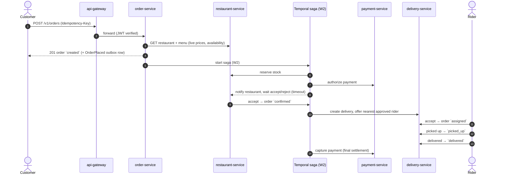

# SmartFoodOps

A microservices-based food ordering and delivery platform (Part A of the SmartFoodOps
assignment — core platform + distributed systems; the GenAI layer is Part B, built later
on top of this).

See [docs/PRD.md](docs/PRD.md) for requirements and feature → deliverable traceability,
[docs/architecture.md](docs/architecture.md) for the full system design,
[docs/technical-documentation.md](docs/technical-documentation.md) for the reasoning
behind each decision, [docs/diagrams.md](docs/diagrams.md) for the microservices
architecture diagram and per-service ER diagrams, and [docs/PROGRESS.md](docs/PROGRESS.md)
for current build status — **read PROGRESS.md first** when picking this project back up in
a new session.

## Architecture at a glance

```
                         ┌────────────┐
                         │ api-gateway│  routing, JWT + deny-list check,
                         │            │  rate limiting, CORS, Swagger index,
                         └──┬───┬───┬─┘  tracking WebSocket/SSE (Week 2)
                            │   │   │
       ┌────────────────────┘   │   └────────────────────┐
       │                        │                         │
┌──────▼──────┐          ┌──────▼──────┐           ┌──────▼──────┐
│ user-service│          │ restaurant- │           │order-service│──► Temporal
│  (own DB)   │          │  service    │           │  (own DB)   │    (order saga,
└─────────────┘          │  (own DB)   │           └──────┬──────┘     Week 2)
                          └─────────────┘                  │
       ┌─────────────────────────────────┬─────────────────┴──────────┐
       │                                 │                            │
┌──────▼──────┐                  ┌───────▼──────┐            ┌────────▼───────┐
│delivery-svc │                  │payment-service│            │notification-svc│
│ (DB + Mongo)│                  │   (own DB)    │            │    (own DB)    │
└─────────────┘                  └───────────────┘            └────────────────┘

   The gateway routes to every service (only three are drawn for space).
   Domain events go to Kafka (order-events / delivery-events / payment-events) via
   the transactional outbox pattern — outbox rows are written from Week 1; the
   Kafka relay lands in Week 3.
```

Every service owns its own database — no service reads another's DB directly.
Cross-service contact happens only via sync REST (built: order → restaurant for pricing),
the Temporal order saga (Week 2), Kafka domain events (Week 3), or Celery background jobs
(Week 3). Full rationale in [docs/architecture.md](docs/architecture.md); component and ER
diagrams in [docs/diagrams.md](docs/diagrams.md).

### Order + delivery flow

Target Part A flow. Week 1 implements the first step: validate, price, and persist the
order. The saga that drives the rest starts in Week 2.



## Core workflows

Full state transitions, compensation matrix and consistency model:
[docs/technical-documentation.md](docs/technical-documentation.md#order-lifecycle).

- **Order lifecycle**: `created → awaiting_restaurant_acceptance → confirmed → assigned →
  picked_up → delivered`, plus `rejected`/`cancelled`. Week 1: order creation validates the
  restaurant and items against `restaurant-service`, prices server-side, requires an
  `Idempotency-Key`, and records a status-history audit row. Week 2: a Temporal saga in
  `order-service` drives every later transition.
- **Delivery lifecycle**: rider registration, admin vetting, availability and location
  (Week 1) → proximity-based assignment → pickup → delivery (Week 2), with real-time customer tracking split by traffic shape (REST
  ingestion from riders, WebSocket/SSE push to customers) — see
  [architecture.md#real-time-delivery-tracking](docs/architecture.md#real-time-delivery-tracking).
- **Cancellation/refund**: Temporal signal-driven compensation (release stock, refund
  payment, unassign rider) depending on how far the order had progressed — Week 2.

## Tech stack

Used by the code today: Python, FastAPI, PostgreSQL (database-per-service), MongoDB, Redis,
Docker Compose. Already running in Compose, used from Week 2: Temporal. Already running in
Compose, used from Week 3: Kafka + Schema Registry, Celery + RabbitMQ. Added in Week 3:
Prometheus + Grafana, Jaeger, OpenTelemetry. Dependency management via `uv` workspaces. Full library-level choices
(ORM, JWT, Kafka client, etc.) with rationale in
[docs/technical-documentation.md](docs/technical-documentation.md#library--tooling-choices).

## Local setup

Requires Docker + Docker Compose, and [uv](https://docs.astral.sh/uv/) if you want to run
anything outside containers (tests, the seed script).

1. For each service under `services/`, copy its `env.example` to `.env` (dummy local
   values are already fine for dev — see
   [architecture.md#conventions](docs/architecture.md#conventions) for why these are
   named `env.example` rather than the more common `.env.example`):

   ```bash
   for d in services/*/; do [ -f "$d/env.example" ] && cp "$d/env.example" "$d/.env"; done
   ```

2. Bring the whole stack up:

   ```bash
   docker compose up --build
   ```

   This starts per-service Postgres containers, Mongo, Redis, RabbitMQ, Kafka + Schema
   Registry, Temporal (+ UI on `:8088`), and all app services (`api-gateway` on `:8080`).
   Each service runs its own Alembic migrations on startup. Wait for `docker compose ps`
   to show everything healthy.

3. Seed demo data (a restaurant, menu, rider, and customer) through the gateway:

   ```bash
   uv run --group dev python scripts/seed.py
   ```

4. Everything is reachable through the gateway at `http://localhost:8080`. Try:

   ```bash
   curl http://localhost:8080/v1/restaurants
   ```

   Placing an order needs a customer token and an `Idempotency-Key` header. Only item IDs
   and quantities are sent, because prices come from the restaurant's menu:

   ```bash
   curl -X POST http://localhost:8080/v1/orders \
     -H "Authorization: Bearer $CUSTOMER_TOKEN" \
     -H "Idempotency-Key: $(uuidgen)" \
     -H "Content-Type: application/json" \
     -d '{"restaurant_id": "...", "delivery_address_text": "1 Main St",
          "delivery_lat": 24.86, "delivery_lng": 67.01,
          "items": [{"menu_item_id": "...", "quantity": 2}]}'
   ```

`api-gateway` runs as a single container locally — no reverse proxy in front of it, and no
`--scale` demo. Horizontally scaling it behind a load balancer is a real design decision
(see [docs/technical-documentation.md: Gateway](docs/technical-documentation.md#gateway-single-entry-point-not-a-spof)),
just not one a single dev machine can meaningfully demonstrate — that's a Kubernetes
`Deployment`/`HPA` + `Service` in production, not a local Docker Compose feature.

### Running tests for a single service

```bash
cd services/user-service
uv sync
uv run --group dev pytest
```

(Each service is an independent `uv` project within the workspace — running `uv sync`
inside one service directory resyncs the shared workspace `.venv` to that service's own
dependency closure. This is expected, not a bug — see
[docs/architecture.md](docs/architecture.md) for why each service is a self-contained
package.)

### Lint, types and tests

```bash
./scripts/check.sh          # ruff lint + format check, mypy per service, every service's tests
uvx pre-commit install      # once: ruff + mypy run on every commit
```

`mypy` runs per service (`scripts/typecheck.sh`), not over the whole repo, because every
service has its own top-level `app` package.

## API overview

Every service auto-generates its own OpenAPI/Swagger docs (no hand-maintained endpoint
list to go stale) — browse them all from one place once the stack is up:

**http://localhost:8080/docs**

Or hit a specific service's docs directly, e.g. `http://localhost:8080/docs/order-service`.

Clients only ever talk to the gateway — it routes each `/v1/{resource}/...` call to the
service that owns that resource (configured in `services/api-gateway/app/config.py`).
Key endpoints per service are listed in
[docs/technical-documentation.md](docs/technical-documentation.md#service-breakdown).
Resource → owning service:

| Resource prefix | Service |
|---|---|
| `/v1/auth`, `/v1/users` | user-service |
| `/v1/restaurants` | restaurant-service |
| `/v1/orders` | order-service |
| `/v1/riders` | delivery-service |
| `/v1/payments` | payment-service |
| `/v1/notifications` | notification-service |

The gateway also serves its own `/health`, `/docs`, and `/docs/{service}` routes.
