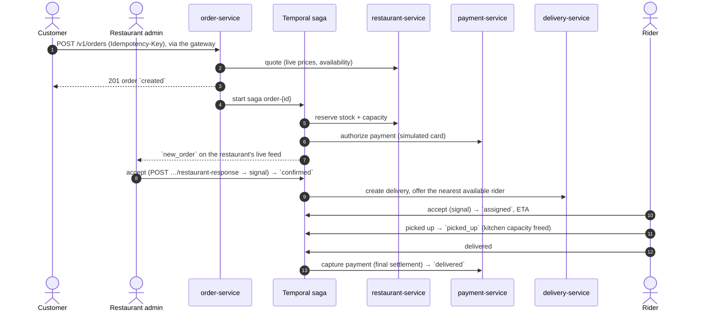

# SmartFoodOps

A microservices-based food ordering and delivery platform (Part A of the SmartFoodOps
assignment — core platform + distributed systems; the GenAI layer is Part B, built later
on top of this).

See [docs/PRD.md](docs/PRD.md) for requirements and feature → deliverable traceability,
[docs/architecture.md](docs/architecture.md) for the full system design,
[docs/technical-documentation.md](docs/technical-documentation.md) for the reasoning
behind each decision, [docs/diagrams.md](docs/diagrams.md) for the component diagram, order-lifecycle
sequence diagrams and per-service ER diagrams, and [docs/PROGRESS.md](docs/PROGRESS.md)
for current build status — **read PROGRESS.md first** when picking this project back up in
a new session.

## Architecture at a glance

```
                               clients (REST + SSE)
                                        │
                               ┌────────▼────────┐  routing, JWT + deny-list check,
                               │   api-gateway   │  rate limiting, CORS, Swagger
                               └────────┬────────┘  index, SSE streaming proxy
       ┌───────────────┬────────────────┼────────────────┬─────────────────┐
┌──────▼──────┐ ┌──────▼──────┐ ┌───────▼───────┐ ┌──────▼──────┐ ┌────────▼───────┐
│ user-service│ │ restaurant- │ │ order-service │ │  delivery-  │ │tracking-service│
│             │ │   service   │ │ + saga        │ │   service   │ │ SSE, no DB     │
└─────────────┘ └──────▲──────┘ └───────┬───────┘ └──────▲──────┘ └────────▲───────┘
                       │                │ start          │                 │
                       │       ┌────────▼────────┐       │                 │ Pub/Sub +
                       └───────┤ Temporal server ├───────┘                 │ state keys
                    activities └────────┬────────┘ activities      ┌───────┴───────┐
                                        │ activities               │     Redis     │
                                ┌───────▼───────┐                  └───────▲───────┘
                                │payment-service│        order- and delivery-service
                                └───────────────┘        publish status, ETA, location

   The gateway also routes to payment- and notification-service (not drawn).
   Each service has its own database and runs its own Temporal worker on its own task
   queue: the saga in order-service schedules activities next to the data they change.
   Domain events are written to each service's outbox; the Kafka relay lands in Week 3.
```

Every service owns its own database — no service reads another's DB directly.
Cross-service contact happens only via sync REST (order → restaurant for the quote), the
Temporal order saga, Redis Pub/Sub for live tracking, Kafka domain events (Week 3), or
Celery background jobs (Week 3). Full rationale in [docs/architecture.md](docs/architecture.md);
component, sequence and ER diagrams in [docs/diagrams.md](docs/diagrams.md).

### Order + delivery flow

As built. The order is created synchronously; everything after runs in the Temporal saga,
and the customer and restaurant watch it on live SSE feeds.



Failures and cancellations before pickup run the saga's compensations (void payment,
release stock, free the rider); diagrams for reassignment, cancellation and refunds are in
[docs/diagrams.md](docs/diagrams.md).

## Core workflows

Full state transitions, compensation matrix and consistency model:
[docs/technical-documentation.md](docs/technical-documentation.md#order-lifecycle).

- **Order lifecycle**: `created → awaiting_restaurant_acceptance → confirmed → assigned →
  picked_up → delivered`, plus `rejected`/`cancelled`. Creation validates and prices
  server-side and needs an `Idempotency-Key`; a Temporal saga in `order-service` drives
  every later transition, with a 5-minute restaurant decision timeout.
- **Delivery lifecycle**: rider registration, admin vetting, availability and location
  pings → nearest available rider offered (Redis GEO), 60s to accept → reassignment on
  decline, expiry or drop-out → pickup → delivery, with ETAs.
- **Live tracking**: customers follow their order and restaurants get new orders over SSE
  (`/v1/tracking/...`), served by `tracking-service` from Redis Pub/Sub.
- **Cancellation/refund**: cancel until pickup — the saga compensates for whatever had
  happened (release stock, void payment, free the rider). After delivery a system admin
  can refund all or part of an order.

## Tech stack

Used by the code today: Python, FastAPI, PostgreSQL (database-per-service), MongoDB, Redis
(cache, deny-list, rate limits, rider GEO pool, Pub/Sub for live tracking), Temporal (order
saga), Docker Compose. Already running in Compose, used from Week 3: Kafka + Schema Registry, Celery + RabbitMQ. Added in Week 3:
Prometheus + Grafana, Jaeger, OpenTelemetry. Dependency management via `uv` workspaces. Full library-level choices
(ORM, JWT, Kafka client, etc.) with rationale in
[docs/technical-documentation.md](docs/technical-documentation.md#library--tooling-choices).

## Local setup

Requires Docker + Docker Compose, and [uv](https://docs.astral.sh/uv/) if you want to run
anything outside containers (tests, the seed script).

1. For each service under `services/`, copy its `env.example` to `.env` (dummy local
   values are already fine for dev — see
   [architecture.md#conventions](docs/architecture.md#conventions) for why these are
   named `env.example` rather than the more common `.env.example`). `JWT_SECRET` must be
   the same in every service's `.env`; if you've changed it in an existing setup, set the
   same value in `services/tracking-service/.env` too:

   ```bash
   for d in services/*/; do [ -f "$d/env.example" ] && cp "$d/env.example" "$d/.env"; done
   ```

2. Bring the whole stack up:

   ```bash
   docker compose up --build
   ```

   This starts per-service Postgres containers, Mongo, Redis, RabbitMQ, Kafka + Schema
   Registry, Temporal (the Temporal CLI dev server, web UI on `:8088`), and all app
   services (`api-gateway` on `:8080`).
   Each service runs its own Alembic migrations on startup. Wait for `docker compose ps`
   to show everything healthy.

3. Seed demo data (a restaurant, menu, two riders, a customer and an admin) through the
   gateway:

   ```bash
   uv run --group dev python scripts/seed.py
   ```

4. Everything is reachable through the gateway at `http://localhost:8080`. Try:

   ```bash
   curl http://localhost:8080/v1/restaurants
   ```

   Placing an order needs a customer token and an `Idempotency-Key` header. Only item IDs
   and quantities are sent, because prices come from the restaurant's menu:

   ```bash
   curl -X POST http://localhost:8080/v1/orders \
     -H "Authorization: Bearer $CUSTOMER_TOKEN" \
     -H "Idempotency-Key: $(uuidgen)" \
     -H "Content-Type: application/json" \
     -d '{"restaurant_id": "...", "delivery_address_text": "1 Main St",
          "delivery_lat": 24.86, "delivery_lng": 67.01,
          "items": [{"menu_item_id": "...", "quantity": 2}]}'
   ```

`api-gateway` runs as a single container locally — no reverse proxy in front of it, and no
`--scale` demo. Horizontally scaling it behind a load balancer is a real design decision
(see [docs/technical-documentation.md: Gateway](docs/technical-documentation.md#gateway-single-entry-point-not-a-spof)),
just not one a single dev machine can meaningfully demonstrate — that's a Kubernetes
`Deployment`/`HPA` + `Service` in production, not a local Docker Compose feature.

### Running tests for a single service

```bash
cd services/user-service
uv sync
uv run --group dev pytest
```

(Each service is an independent `uv` project within the workspace — running `uv sync`
inside one service directory resyncs the shared workspace `.venv` to that service's own
dependency closure. This is expected, not a bug — see
[docs/architecture.md](docs/architecture.md) for why each service is a self-contained
package.)

### Lint, types and tests

```bash
./scripts/check.sh            # ruff lint + format check, mypy per service, every service's tests
./scripts/check.sh --with-db  # + tests against real Postgres/Redis (needs `docker compose up`)
uvx pre-commit install      # once: ruff + mypy run on every commit
```

`mypy` runs per service (`scripts/typecheck.sh`), not over the whole repo, because every
service has its own top-level `app` package.

### Debugging one request across services

Every response carries an `X-Request-ID` header, and every service logs under that
same ID as `trace_id`. To see one request's whole path:

```bash
docker compose logs --no-log-prefix | grep <x-request-id>
```

### Smoke test (whole running system)

```bash
docker compose up -d && uv run --group dev python scripts/seed.py
uv run --group dev python scripts/smoke_test.py          # API only, through the gateway
uv run --group dev python scripts/smoke_test.py --deep   # + checks inside local Docker
uv run --group dev python scripts/smoke_test.py --deep --lifecycle  # + whole orders (~2 min)
```

One end-to-end test for the platform, not one per service: it drives the system through
`api-gateway` like a client (auth, browsing, caching, ordering, admin views, riders), so it
catches what per-service tests can't — routing, migrations, config, service-to-service
calls. `--deep` also checks each service's `/readyz`/`/livez`, the Redis menu cache,
refresh-token storage, the Mongo location ping, and that one order's trace ID shows up
in the gateway, order-service and restaurant-service logs. `--lifecycle` runs whole orders
through the saga: the happy path watched on both live feeds, restaurant rejection, card
decline, cancellation after assignment, rider decline and drop-out (reassignment), two
orders racing for the last unit of stock, and a partial refund. `--base-url` points it at
another deployment. Safe to re-run; exits non-zero on any failure.

## API overview

Every service auto-generates its own OpenAPI/Swagger docs (no hand-maintained endpoint
list to go stale) — browse them all from one place once the stack is up:

**http://localhost:8080/docs**

Or hit a specific service's docs directly, e.g. `http://localhost:8080/docs/order-service`.

Clients only ever talk to the gateway — it routes each `/v1/{resource}/...` call to the
service that owns that resource (configured in `services/api-gateway/app/config.py`).
Key endpoints per service are listed in
[docs/technical-documentation.md](docs/technical-documentation.md#service-breakdown).
Resource → owning service:

| Resource prefix | Service |
|---|---|
| `/v1/auth`, `/v1/users` | user-service |
| `/v1/restaurants` | restaurant-service |
| `/v1/orders` | order-service |
| `/v1/riders`, `/v1/deliveries` | delivery-service |
| `/v1/payments` | payment-service |
| `/v1/notifications` | notification-service |
| `/v1/tracking` (SSE) | tracking-service |

The gateway also serves its own `/livez`, `/readyz` (and `/health`, same as `/readyz`), `/docs`,
and `/docs/{service}` routes.
