# SmartFoodOps — Diagrams

Mermaid diagrams, rendered natively by GitHub — kept as text so they can't silently drift
out of sync with the code the way an exported image would. See
[architecture.md](./architecture.md) for the prose description of everything here.

## Microservices architecture

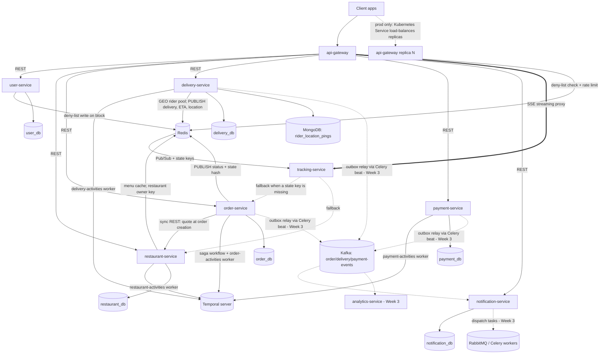

Solid arrows are built; dotted arrows are Week 3 (per [PROGRESS.md](./PROGRESS.md)), the
tracking-service fallbacks (`/internal/*` calls made only when a Redis state key is
missing), or, for the `api-gateway` replica line, production-only (Kubernetes
`Deployment`/`HPA` + `Service` — never built locally, see
[technical-documentation.md](./technical-documentation.md#gateway-single-entry-point-not-a-spof)
for why). Each service's Temporal worker runs inside the service process in development
and as a separate process (`python -m app.worker`) in production. Live tracking goes
through Redis Pub/Sub, not Kafka: it needs sub-second push to whoever is watching, not a
replayable log. Every database is a separate Postgres container — database-per-service,
no shared instance.

## Order lifecycle (sequence)

The happy path, as built. Every arrow into "Saga" from an endpoint is a Temporal signal;
every arrow out of it is an activity on that service's own task queue.

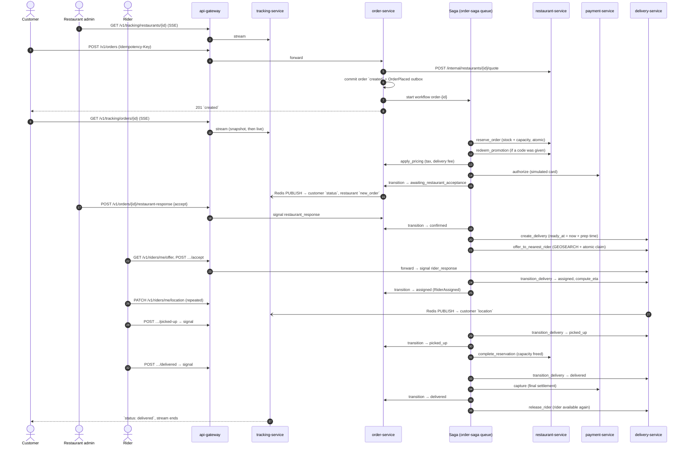

## Rider assignment and reassignment

One offer at a time, nearest first. A rider who declines, lets the offer expire, or drops
out is never offered that order again.

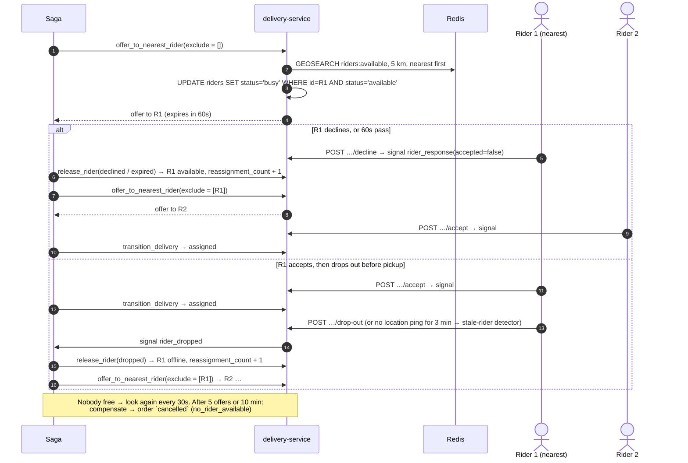

## Cancellation and compensation

A customer (or system admin) can cancel until pickup. The saga undoes, in reverse order,
only what it actually did; every compensation is idempotent and retried until it succeeds.

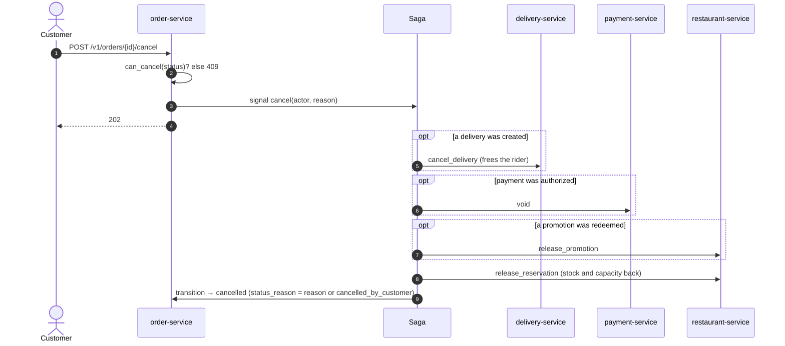

The same compensation runs on every failure before pickup: restaurant rejects or doesn't
answer in 5 min (`rejected`), out of stock / at capacity / card declined (`rejected`), no
rider (`cancelled`). After pickup nothing is undone — the remaining steps retry until they
succeed, and a problem becomes a refund.

## Post-delivery refund

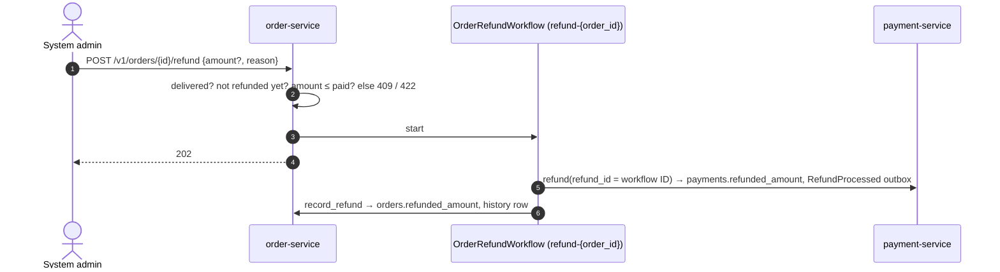

## Entity-relationship diagrams (one per service database)

No cross-service foreign keys anywhere — a column referencing another service's entity is
annotated as an opaque reference (e.g. `"opaque -> user_db.users.id"`), not a real FK,
since that would violate the database-per-service boundary.

### `user_db`

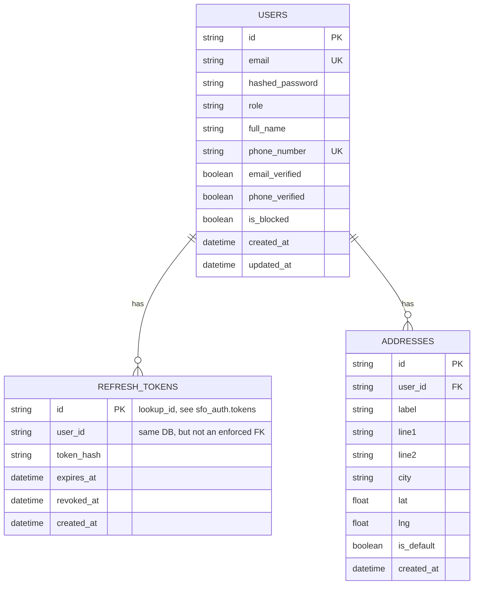

### `restaurant_db`

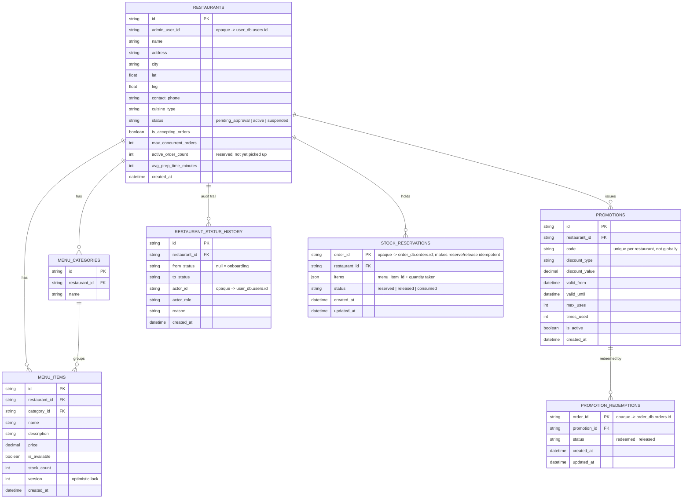

A release that arrives before its reserve leaves a `released` row (`restaurant_id` /
`promotion_id` null), so a late reserve is a no-op.

### `order_db`

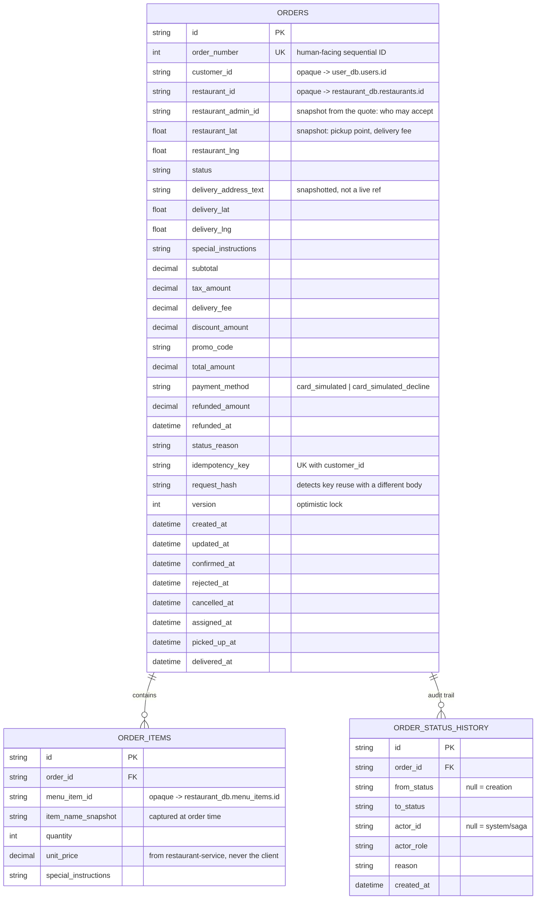

### `delivery_db`

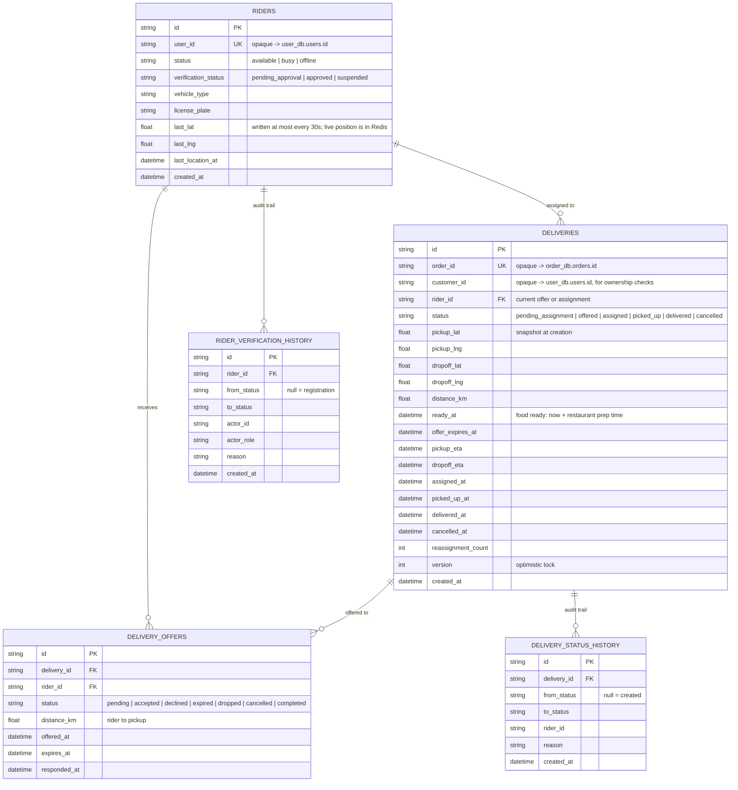

High-frequency rider location pings live in MongoDB, not this diagram —
the live position and the assignment pool are in Redis (`rider:{id}:location`, GEO set
`riders:available`), and `riders.last_lat/last_lng` is a throttled copy:

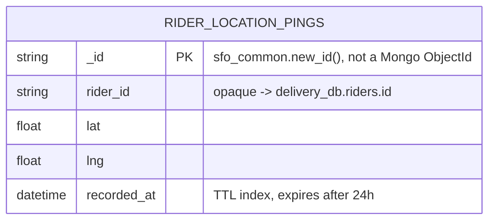

### `payment_db`

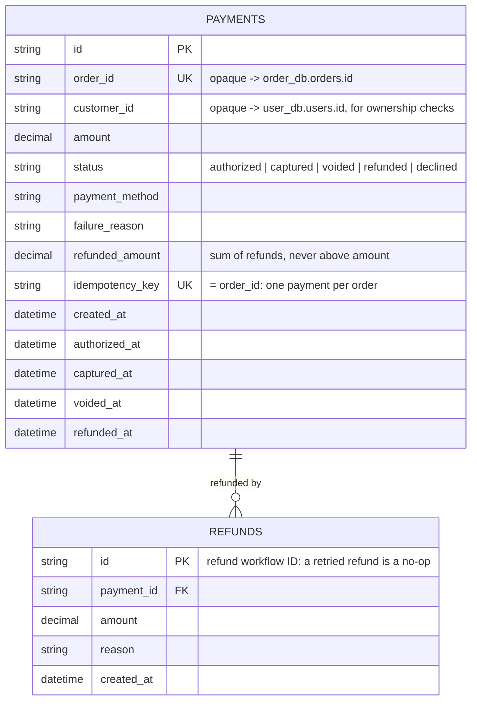

### `notification_db`

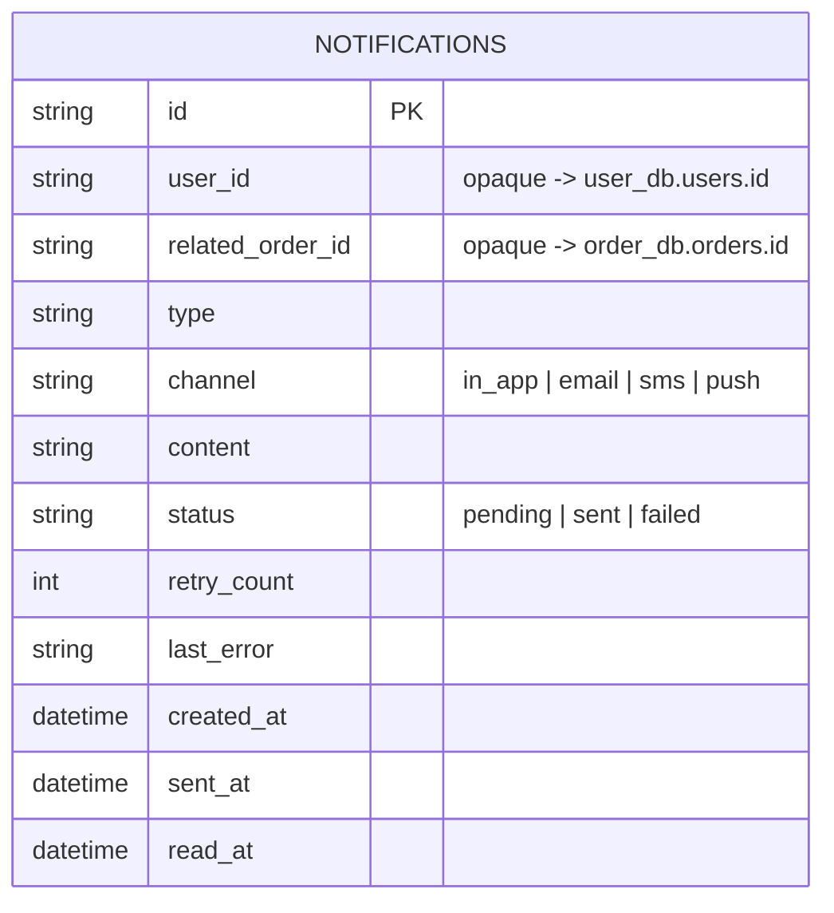

### `outbox_events` (shared shape, present in `restaurant_db`/`order_db`/`delivery_db`/`payment_db`)

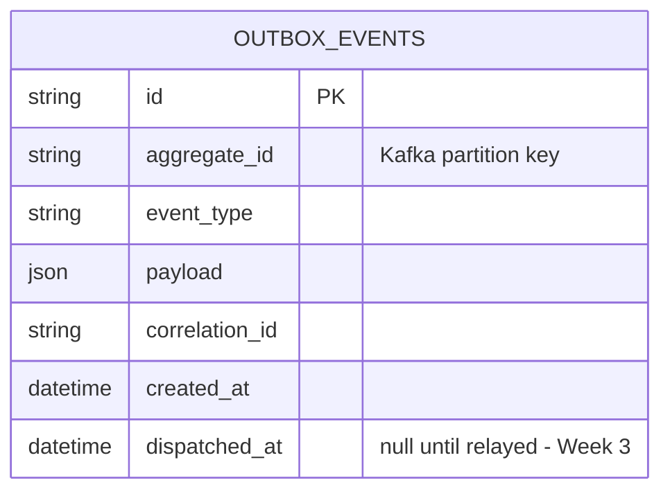
