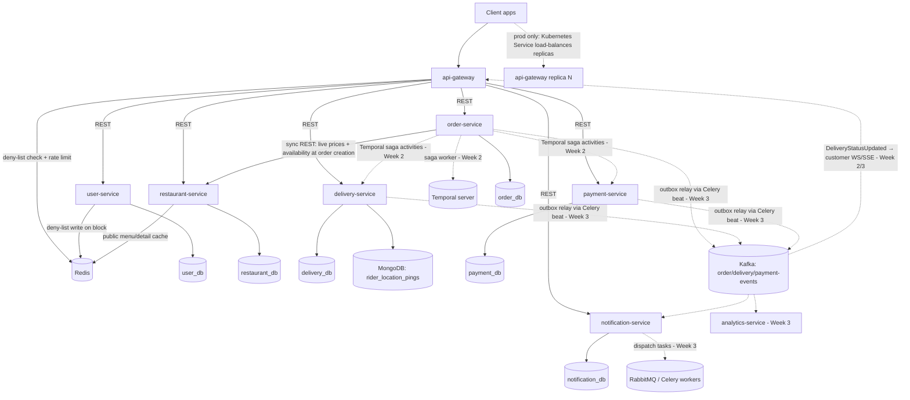
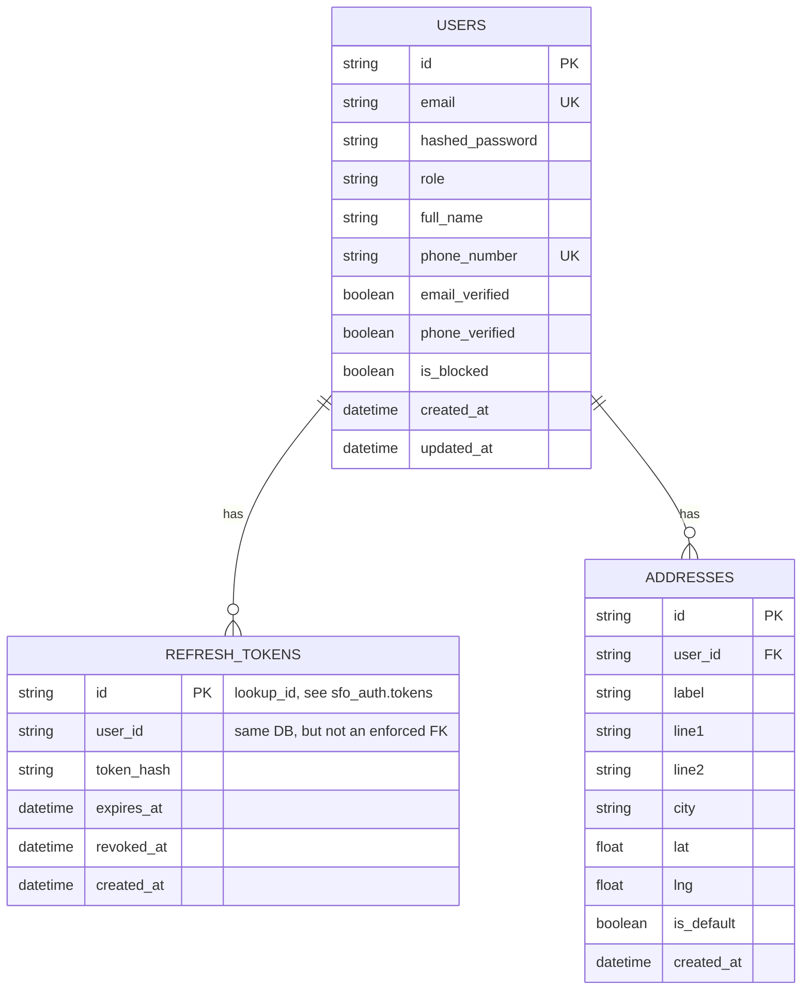
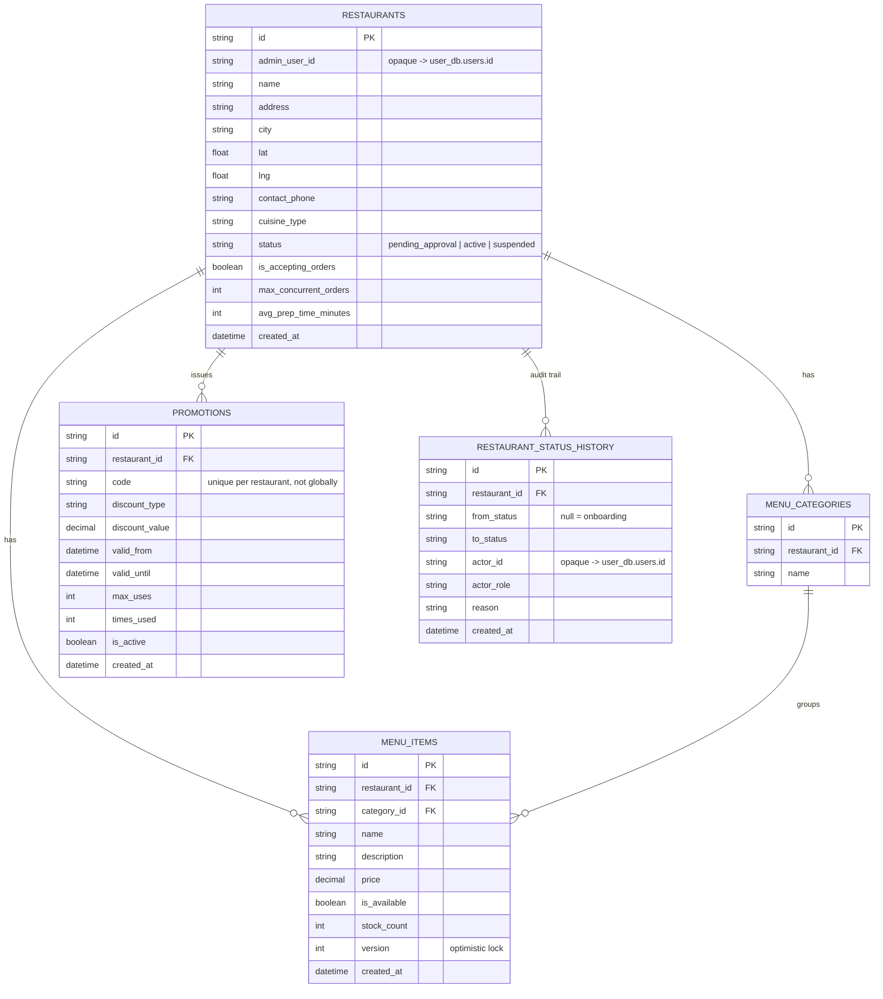
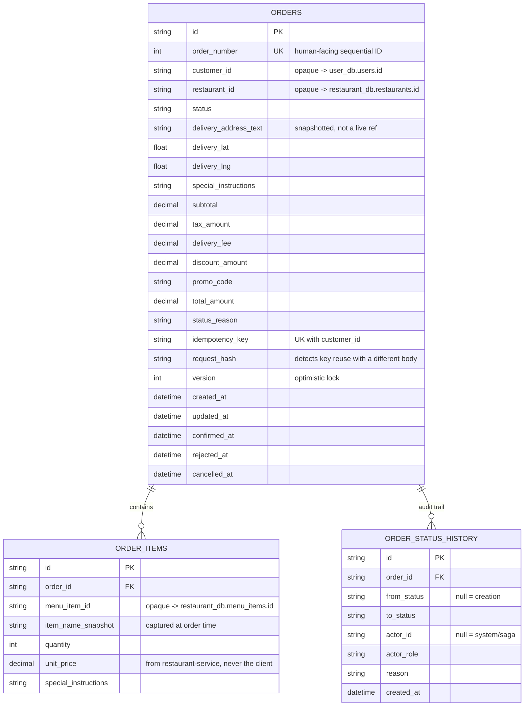
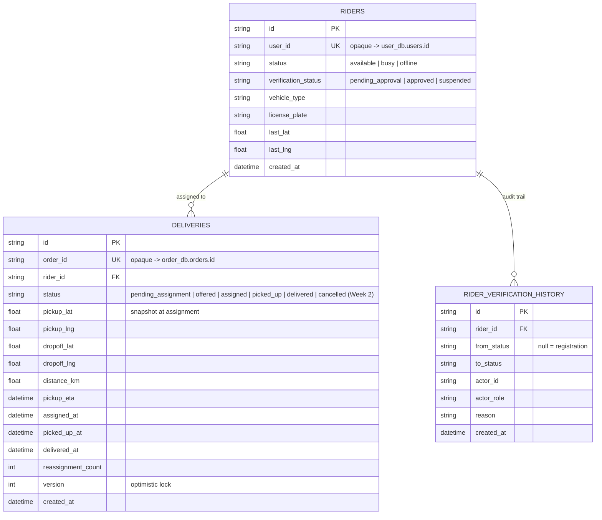
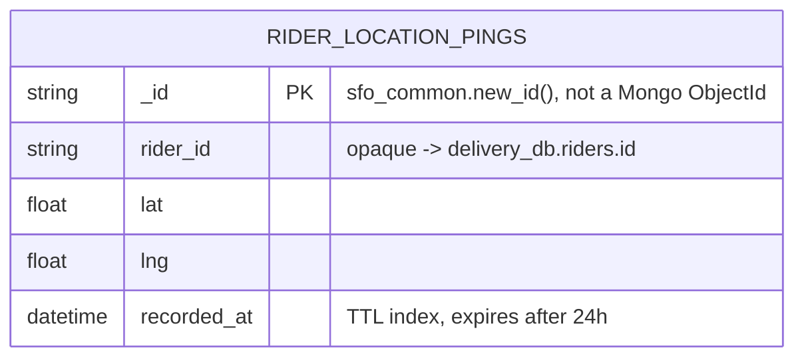
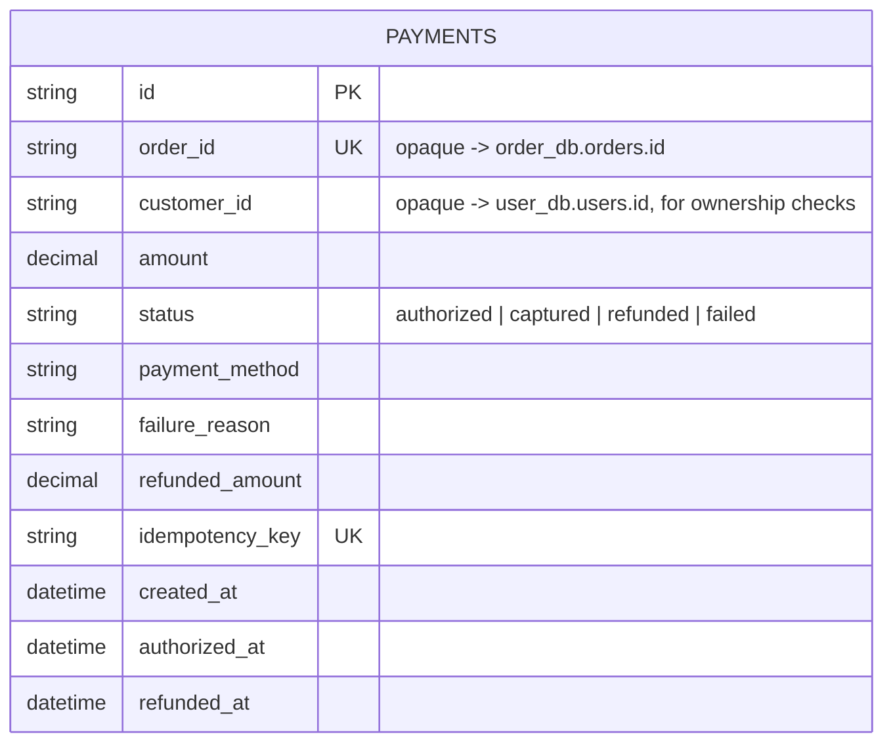
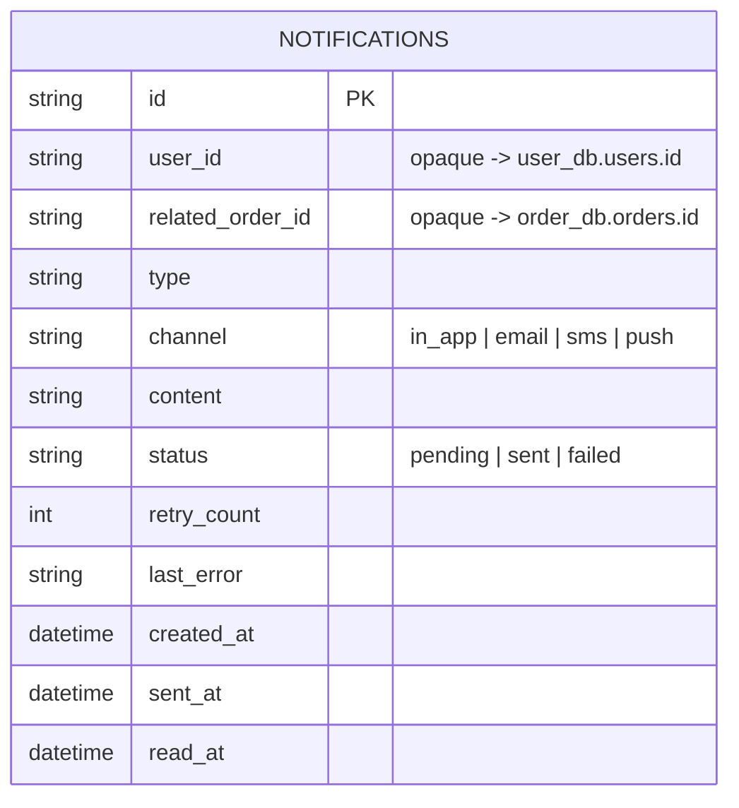
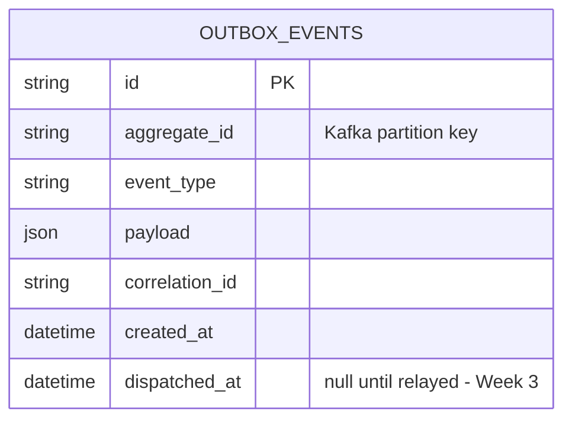

# SmartFoodOps — Diagrams

Mermaid diagrams, rendered natively by GitHub — kept as text so they can't silently drift
out of sync with the code the way an exported image would. See
[architecture.md](./architecture.md) for the prose description of everything here.

## Microservices architecture

Solid arrows are built (Week 1); dotted arrows are either Week 2/3 (per
[PROGRESS.md](./PROGRESS.md)) or, for the `api-gateway` replica line specifically,
production-only (Kubernetes `Deployment`/`HPA` + `Service` — never built locally, see
[technical-documentation.md](./technical-documentation.md#gateway-single-entry-point-not-a-spof)
for why). `restaurant-service` has no Kafka topic: nothing downstream consumes restaurant
changes in Part A. Every database is a separate Postgres container — database-per-service, no
shared instance.

## Entity-relationship diagrams (one per service database)

No cross-service foreign keys anywhere — a column referencing another service's entity is
annotated as an opaque reference (e.g. `"opaque -> user_db.users.id"`), not a real FK,
since that would violate the database-per-service boundary.

### `user_db`

### `restaurant_db`

### `order_db`

### `delivery_db`

High-frequency rider location pings live in MongoDB, not this diagram —
`riders.last_lat/last_lng` is only the latest known position used for assignment queries:

### `payment_db`

### `notification_db`

### `outbox_events` (shared shape, present in `restaurant_db`/`order_db`/`delivery_db`/`payment_db`)

