# SmartFoodOps — Diagrams

Mermaid diagrams, rendered natively by GitHub — kept as text so they can't silently drift
out of sync with the code the way an exported image would. See
[architecture.md](./architecture.md) for the prose description of everything here.

## Microservices architecture

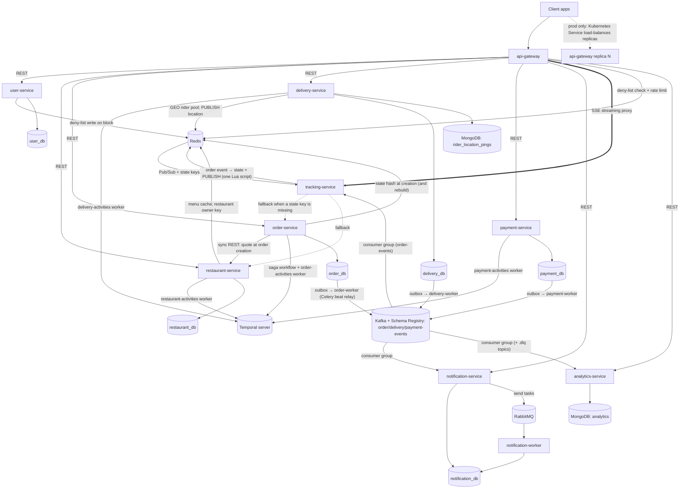

Solid arrows are built; dotted arrows are the
tracking-service fallbacks (`/internal/*` calls made only when a Redis state key is
missing), or, for the `api-gateway` replica line, production-only (Kubernetes
`Deployment`/`HPA` + `Service` — never built locally, see
[technical-documentation.md](./technical-documentation.md#gateway-single-entry-point-not-a-spof)
for why). Each service's Temporal worker runs inside the service process in development
and as a separate process (`python -m app.worker`) in production. Order and
delivery updates reach live tracking through Kafka (tracking-service's consumer group), so
none is lost; Redis Pub/Sub then carries each one to the tracking replica that holds the
viewer's stream. Rider positions go to Redis directly. Every database is a separate Postgres container — database-per-service,
no shared instance. The relay workers (`order-worker`, `payment-worker`,
`delivery-worker`) also use RabbitMQ — for their beat schedule — not drawn. Every process
also sends traces to Jaeger and serves metrics to Prometheus; see
[Observability](#observability).

## How data moves through one order (REST, Temporal, Pub/Sub, SSE)

A plain-language walkthrough of one order, showing which mechanism carries each piece
of data. Each mechanism has one job:

| Mechanism | Its job | Kept if nobody is listening? |
|---|---|---|
| **REST** (through api-gateway) | A user *does* something: place an order, accept, pick up | — (request/response) |
| **Temporal task queues** | The saga hands *work* to the service that owns the data | ✅ durable, retried |
| **Temporal signals** | Tell the waiting saga that a user acted ("restaurant accepted") | ✅ durable |
| **Redis Pub/Sub** | Carry each change to the tracking-service replica holding the viewer's stream | ❌ — the latest state is saved next to it, sent as a snapshot on (re)connect |
| **SSE** (Server-Sent Events) | Push those changes to open screens (one-way, plain HTTP) | ❌ — the screen gets a fresh snapshot when it reconnects |
| **Outbox → Kafka** | Guaranteed order status updates for live screens, notifications (in-app, email, SMS, via Celery) and analytics | ✅ |

### Overview

Everything in an order travels one of two ways.

**A. Doing things** — a user acts, the saga does the work:

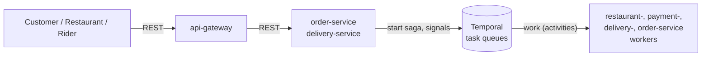

**B. Telling screens** — every change is announced and pushed to whoever is watching.
Order and delivery changes go through Kafka, so they can't be lost; rider positions go
to Redis directly (frequent, and fine to drop one):

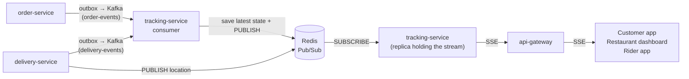

Guaranteed notifications and analytics are a third path — see step 7.

### Step 1 — The customer places the order (REST)

The customer's request is answered straight away; the rest happens in the background.
Order-service checks prices with restaurant-service, saves the order as `created`
(with an `OrderPlaced` outbox row, in the same transaction), writes the order's live
state to Redis, starts the saga, and replies `201`.

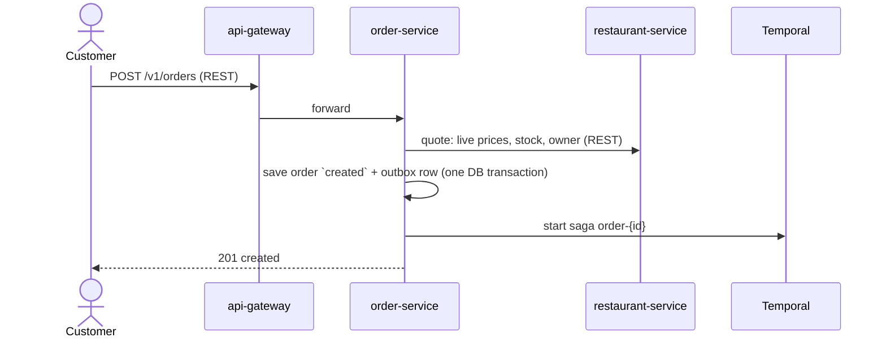

### Step 2 — The saga prepares the order (Temporal task queues)

The saga runs inside order-service's worker. It doesn't call other services' APIs: it
puts each job on the task queue of the service that owns the data, and that service's
worker does it in its own database. Temporal retries a job that fails for a temporary
reason.

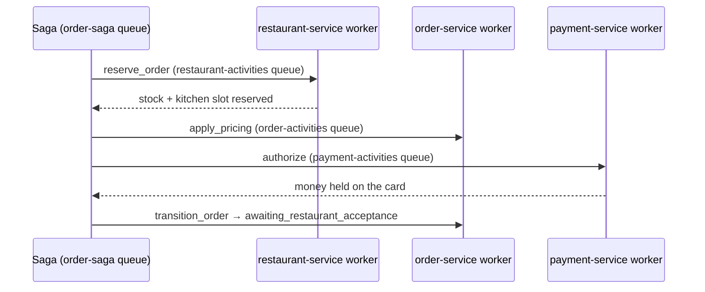

### Step 3 — The restaurant is notified (Kafka → Redis Pub/Sub → SSE)

The status change is saved together with an `OrderAwaitingRestaurant` outbox row. The
relay sends it to Kafka within about a second, and tracking-service's consumer applies
it in one Redis script: it saves the latest state, adds the order to the restaurant's
"waiting" list, and **publishes** `new_order` on the restaurant's channel. The
tracking-service replica holding the open dashboard is subscribed to that channel and
pushes the message down its SSE stream. If Redis or the consumer is down, the event
waits in Kafka and is applied once they're back.

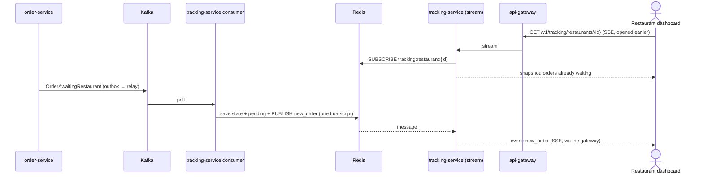

If the dashboard was closed at that moment, nothing is lost: when it reconnects, the
snapshot lists every order still waiting. If nobody answers within 5 minutes, the saga
rejects the order and undoes steps 1–2.

### Step 4 — The restaurant accepts (REST → Temporal signal)

The accept button doesn't change the order itself. Order-service checks that this
admin owns the order and that it's still waiting, then **signals** the saga and replies
`202`. The saga, which was waiting for exactly this, continues.

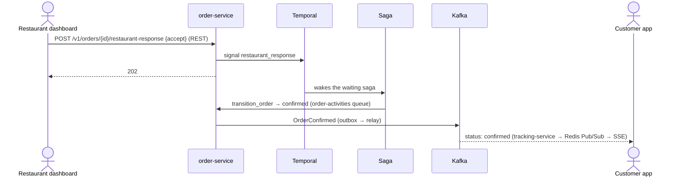

### Step 5 — A rider is offered the order (Temporal task queue → Kafka → SSE)

The saga asks delivery-service to create the delivery and offer it to the nearest free
rider (found with Redis GEO, claimed with one atomic database update). The offer
expires in 60 seconds. Its `DeliveryStatusUpdated` event reaches tracking-service
through Kafka, which pushes `offer` on the rider's live feed; the app then reads the
offer over REST. (The app also checks every 30s, in case its feed is down.)

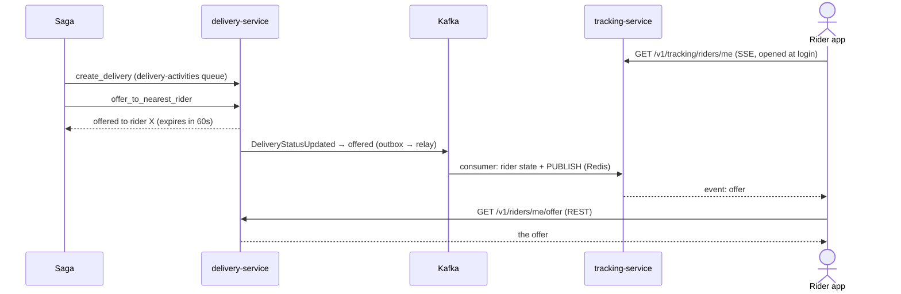

### Step 6 — The rider accepts and delivers; the customer watches live (REST → signal → Pub/Sub → SSE)

Every rider action follows the same pattern: REST to delivery-service, which signals
the saga; the saga makes the change; the change is pushed to the customer (and the
rider's own feed). Order status, delivery status and ETAs arrive through Kafka as in
steps 3–5; location pings are published by delivery-service directly.

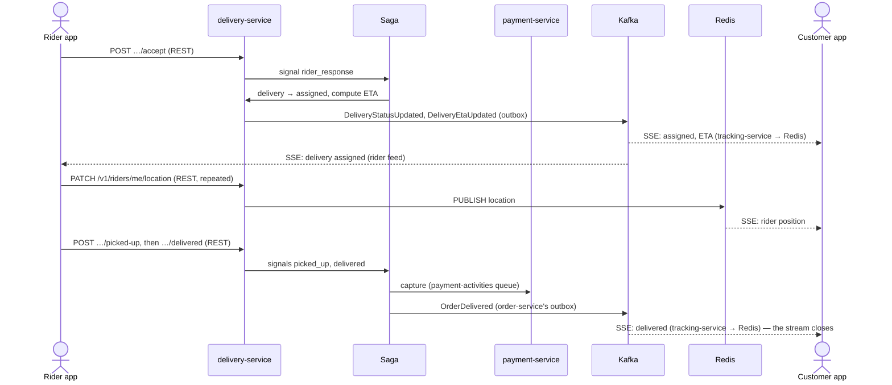

### Step 7 — Guaranteed notifications and analytics (outbox → Kafka → Celery)

Messages that must arrive use the outbox: every change above writes an event row
(`OrderPlaced`, `OrderAwaitingRestaurant`, `RiderAssigned`, …) in the same database
transaction. A relay worker publishes it to Kafka within about a second; tracking-service
updates the live screens (order and delivery status, ETAs, rider offers), notification-service tells the customer,
restaurant and rider, and analytics-service updates its metrics. The full path, with failure handling, is in
[Event flow](#event-flow-outbox--kafka--consumers--celery).

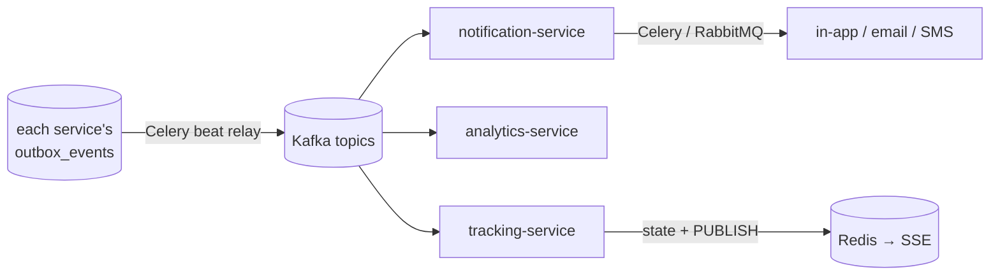

### Summary

| # | Step | Mechanism |
|---|---|---|
| 1 | Customer places the order | REST |
| 2 | Saga reserves stock, prices, holds the money | Temporal task queues |
| 3 | Restaurant sees the new order | Outbox → Kafka → Redis Pub/Sub → SSE |
| 4 | Restaurant accepts | REST → Temporal signal |
| 5 | Rider gets the offer | Temporal task queue; outbox → Kafka → rider's SSE feed, then REST |
| 6 | Rider accepts, moves, delivers; customer watches | REST → signal; status via Kafka, location direct; Redis Pub/Sub → SSE |
| 7 | Live order status; notifications (in-app, email, SMS); analytics | Outbox → Kafka (→ Celery for sends) |

## Event flow (outbox → Kafka → consumers → Celery)

One event from the business write to the notification it causes. Each arrow says what
happens when that hop fails.

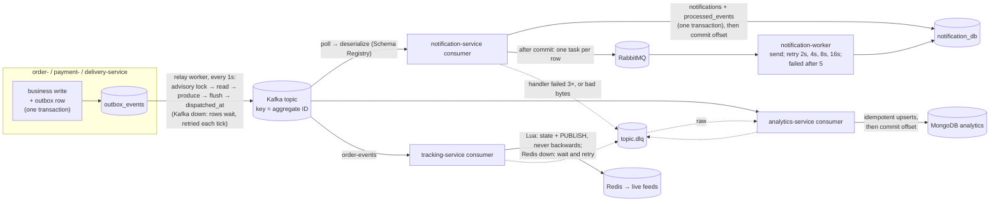

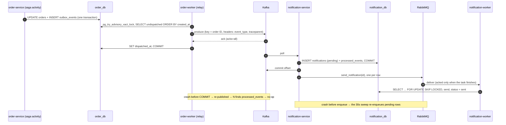

## Trace path (one order = one trace)

The W3C `traceparent` crosses every hop, so the whole order — including the work done
long after the request returned — is one trace in Jaeger.

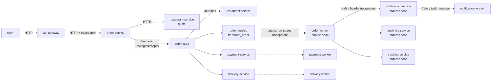

## Observability

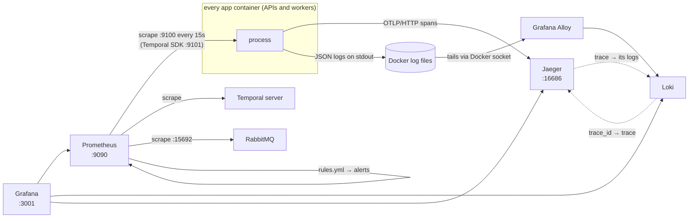

All UIs are bound to localhost. Nothing is pushed to Prometheus — every process serves
its metrics on an internal port, and Prometheus pulls them.

## Order lifecycle (sequence)

The happy path, as built. Every arrow into "Saga" from an endpoint is a Temporal signal;
every arrow out of it is an activity on that service's own task queue.

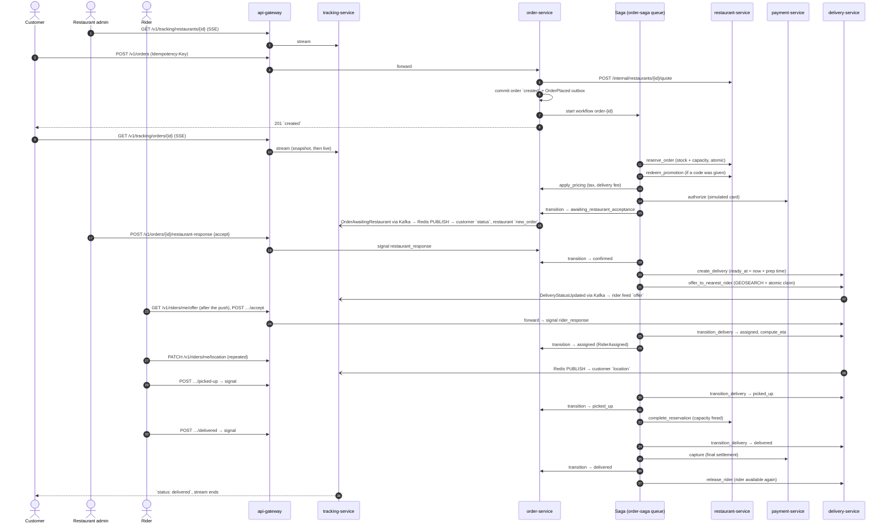

## Rider assignment and reassignment

One offer at a time, nearest first. A rider who declines, lets the offer expire, or drops
out is never offered that order again.

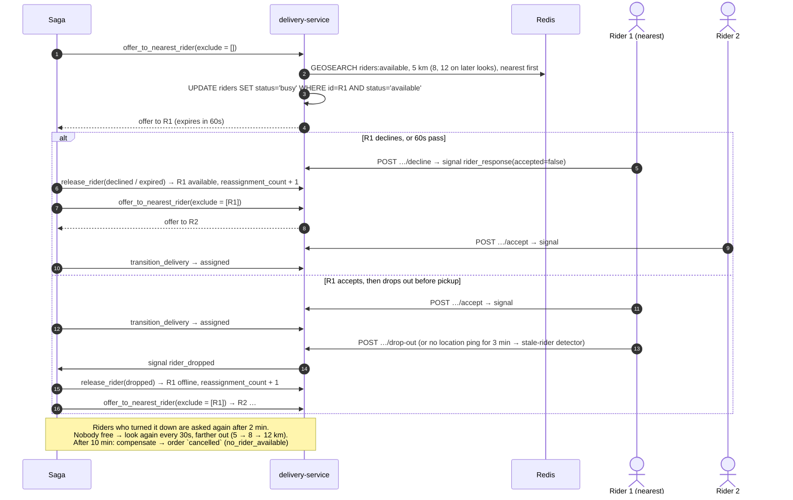

## Cancellation and compensation

A customer (or system admin) can cancel until pickup. The saga undoes, in reverse order,
only what it actually did; every compensation is idempotent and retried until it succeeds.

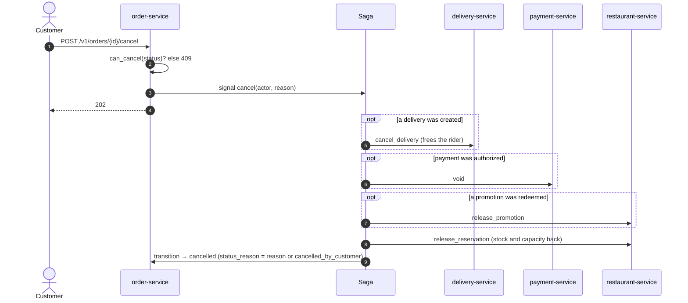

The same compensation runs on every failure before pickup: restaurant rejects or doesn't
answer in 5 min (`rejected`), out of stock / at capacity / card declined (`rejected`), no
rider (`cancelled`). After pickup nothing is undone — the remaining steps retry until they
succeed, and a problem becomes a refund.

## Post-delivery refund

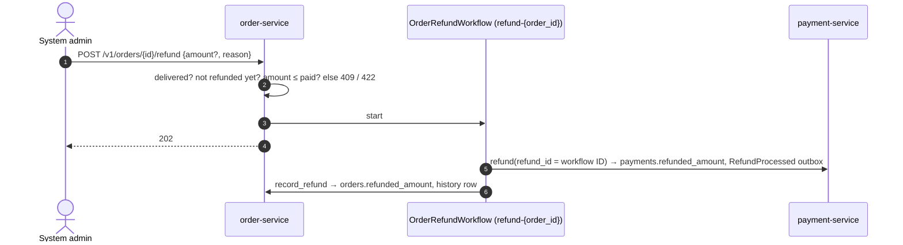

## Entity-relationship diagrams (one per service database)

No cross-service foreign keys anywhere — a column referencing another service's entity is
annotated as an opaque reference (e.g. `"opaque -> user_db.users.id"`), not a real FK,
since that would violate the database-per-service boundary.

### `user_db`

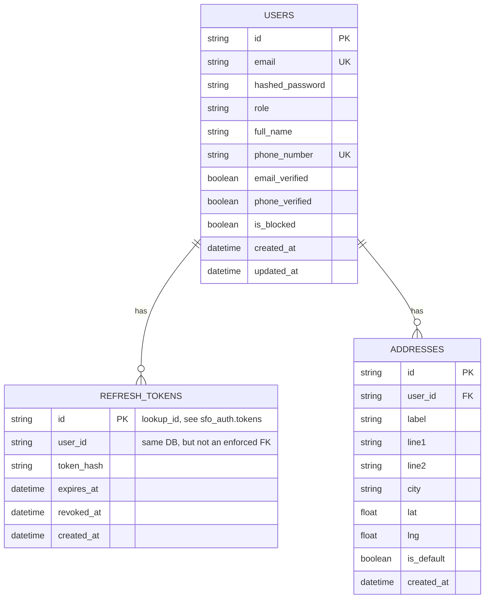

### `restaurant_db`

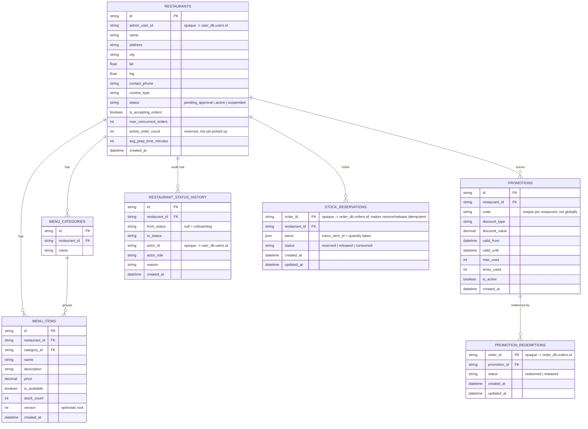

A release that arrives before its reserve leaves a `released` row (`restaurant_id` /
`promotion_id` null), so a late reserve is a no-op.

### `order_db`

```mermaid
erDiagram
    ORDERS ||--o{ ORDER_ITEMS : contains
    ORDERS ||--o{ ORDER_STATUS_HISTORY : "audit trail"

    ORDERS {
        string id PK
        int order_number UK "human-facing sequential ID"
        string customer_id "opaque -> user_db.users.id"
        string restaurant_id "opaque -> restaurant_db.restaurants.id"
        string restaurant_admin_id "snapshot from the quote: who may accept"
        float restaurant_lat "snapshot: pickup point, delivery fee"
        float restaurant_lng
        string status
        string delivery_address_text "snapshotted, not a live ref"
        float delivery_lat
        float delivery_lng
        string special_instructions
        decimal subtotal
        decimal tax_amount
        decimal delivery_fee
        decimal discount_amount
        string promo_code
        decimal total_amount
        string payment_method "card_simulated | card_simulated_decline"
        decimal refunded_amount
        datetime refunded_at
        string status_reason
        string idempotency_key "UK with customer_id"
        string request_hash "detects key reuse with a different body"
        int version "optimistic lock"
        datetime created_at
        datetime updated_at
        datetime confirmed_at
        datetime rejected_at
        datetime cancelled_at
        datetime assigned_at
        datetime picked_up_at
        datetime delivered_at
    }
    ORDER_ITEMS {
        string id PK
        string order_id FK
        string menu_item_id "opaque -> restaurant_db.menu_items.id"
        string item_name_snapshot "captured at order time"
        int quantity
        decimal unit_price "from restaurant-service, never the client"
        string special_instructions
    }
    ORDER_STATUS_HISTORY {
        string id PK
        string order_id FK
        string from_status "null = creation"
        string to_status
        string actor_id "null = system/saga"
        string actor_role
        string reason
        datetime created_at
    }
```

### `delivery_db`

```mermaid
erDiagram
    RIDERS ||--o{ DELIVERIES : "assigned to"
    RIDERS ||--o{ RIDER_VERIFICATION_HISTORY : "audit trail"
    DELIVERIES ||--o{ DELIVERY_OFFERS : "offered to"
    RIDERS ||--o{ DELIVERY_OFFERS : receives
    DELIVERIES ||--o{ DELIVERY_STATUS_HISTORY : "audit trail"

    RIDERS {
        string id PK
        string user_id UK "opaque -> user_db.users.id"
        string status "available | busy | offline"
        string verification_status "pending_approval | approved | suspended"
        string vehicle_type
        string license_plate
        float last_lat "written at most every 30s; live position is in Redis"
        float last_lng
        datetime last_location_at
        datetime created_at
    }
    DELIVERIES {
        string id PK
        string order_id UK "opaque -> order_db.orders.id"
        string customer_id "opaque -> user_db.users.id, for ownership checks"
        string rider_id FK "current offer or assignment"
        string status "pending_assignment | offered | assigned | picked_up | delivered | cancelled"
        float pickup_lat "snapshot at creation"
        float pickup_lng
        float dropoff_lat
        float dropoff_lng
        float distance_km
        datetime ready_at "food ready: now + restaurant prep time"
        datetime offer_expires_at
        datetime pickup_eta
        datetime dropoff_eta
        datetime assigned_at
        datetime picked_up_at
        datetime delivered_at
        datetime cancelled_at
        int reassignment_count
        int version "optimistic lock"
        datetime created_at
    }
    RIDER_VERIFICATION_HISTORY {
        string id PK
        string rider_id FK
        string from_status "null = registration"
        string to_status
        string actor_id
        string actor_role
        string reason
        datetime created_at
    }
    DELIVERY_OFFERS {
        string id PK
        string delivery_id FK
        string rider_id FK
        string status "pending | accepted | declined | expired | dropped | cancelled | completed"
        float distance_km "rider to pickup"
        datetime offered_at
        datetime expires_at
        datetime responded_at
    }
    DELIVERY_STATUS_HISTORY {
        string id PK
        string delivery_id FK
        string from_status "null = created"
        string to_status
        string rider_id
        string reason
        datetime created_at
    }
```

High-frequency rider location pings live in MongoDB, not this diagram —
the live position and the assignment pool are in Redis (`rider:{id}:location`, GEO set
`riders:available`), and `riders.last_lat/last_lng` is a throttled copy:

```mermaid
erDiagram
    RIDER_LOCATION_PINGS {
        string _id PK "sfo_common.new_id(), not a Mongo ObjectId"
        string rider_id "opaque -> delivery_db.riders.id"
        float lat
        float lng
        datetime recorded_at "TTL index, expires after 24h"
    }
```

### `payment_db`

```mermaid
erDiagram
    PAYMENTS ||--o{ REFUNDS : "refunded by"

    PAYMENTS {
        string id PK
        string order_id UK "opaque -> order_db.orders.id"
        string customer_id "opaque -> user_db.users.id, for ownership checks"
        decimal amount
        string status "authorized | captured | voided | refunded | declined"
        string payment_method
        string failure_reason
        decimal refunded_amount "sum of refunds, never above amount"
        string idempotency_key UK "= order_id: one payment per order"
        datetime created_at
        datetime authorized_at
        datetime captured_at
        datetime voided_at
        datetime refunded_at
    }
    REFUNDS {
        string id PK "refund workflow ID: a retried refund is a no-op"
        string payment_id FK
        decimal amount
        string reason
        datetime created_at
    }
```

### `notification_db`

```mermaid
erDiagram
    NOTIFICATIONS {
        string id PK
        string user_id "opaque -> user_db.users.id"
        string recipient_role "customer | restaurant_admin | rider"
        string event_id "the event that caused it"
        string related_order_id "opaque -> order_db.orders.id"
        string type
        string channel "in_app | email | sms"
        string content
        string status "pending | sent | failed"
        int retry_count
        string last_error
        datetime created_at
        datetime last_attempt_at
        datetime sent_at
        datetime read_at
    }
    PROCESSED_EVENTS {
        string event_id PK "Kafka event ID - consumer dedup"
        string consumer
        datetime processed_at
    }
```

`processed_events` is written in the same transaction as the notifications an event
creates, so a redelivered event creates nothing.

### `analytics` (MongoDB, analytics-service)

```mermaid
erDiagram
    ORDER_FACTS {
        string _id PK "order ID"
        int order_number
        string customer_id
        string restaurant_id
        string restaurant_admin_id
        decimal total_amount
        datetime placed_at "$min - first wins"
        datetime sent_to_restaurant_at
        datetime confirmed_at
        datetime rejected_at
        string reject_reason
        datetime cancelled_at
        string cancel_reason
        string cancelled_from "status it was cancelled in"
        datetime assigned_at
        datetime picked_up_at
        datetime delivered_at
        string delivery_id "current delivery"
        string delivery_rider_id
        datetime delivery_offered_at
        datetime delivery_assigned_at
        datetime delivery_ended_at
        array reassignments "event IDs, $addToSet"
        decimal total_refunded "$max"
    }
    RIDER_SHIFT_FACTS {
        string _id PK "event ID"
        string rider_id
        string rider_user_id
        bool on_shift
        string reason
        datetime at
    }
    FAILED_EVENTS {
        string _id PK "dlq topic:partition:offset"
        string original_topic
        string consumer_group
        string event_type
        string error_type
        string error
        datetime at
    }
```

Non-authoritative: everything here is rebuilt by replaying the Kafka topics.

### `outbox_events` (shared shape, present in `restaurant_db`/`order_db`/`delivery_db`/`payment_db`)

```mermaid
erDiagram
    OUTBOX_EVENTS {
        string id PK
        string aggregate_id "Kafka partition key"
        string event_type
        json payload
        string correlation_id
        datetime created_at
        datetime dispatched_at "null until relayed (partial index)"
        string trace_context "writer's W3C traceparent"
        int publish_attempts "failed publishes"
        string last_error
    }
```

restaurant-service has the table but writes no events.
