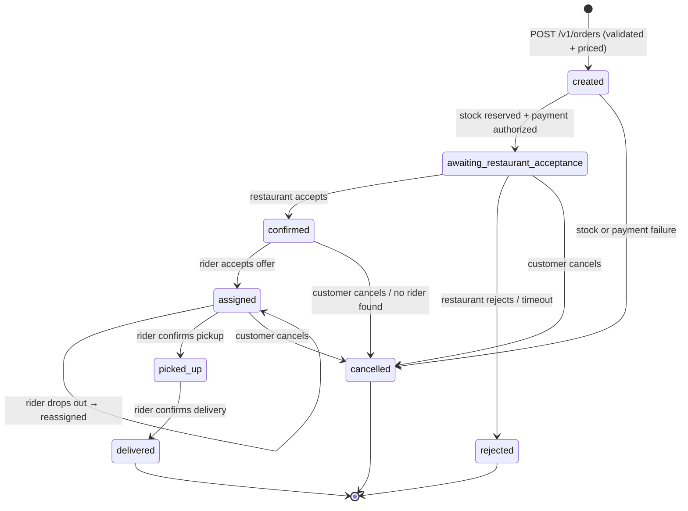

# SmartFoodOps — Technical Documentation (Part A)

This document covers the service breakdown, the order and delivery lifecycles, the
event-driven design, failure handling, and data consistency, followed by the *why* behind
the decisions in [architecture.md](./architecture.md): key tradeoffs, rejected
alternatives, and what's implemented vs. explicitly deferred. Requirements and
traceability are in [PRD.md](./PRD.md); build status is in [PROGRESS.md](./PROGRESS.md).
Anything not yet built is marked **(Week 2)** or **(Week 3)**.

## Why microservices, not a modular monolith

Company requirement: true microservices, production-oriented, able to demonstrate handling
high traffic — not a monolith with internal module boundaries. Each of the 7 services (the
gateway plus six domain services; `analytics-service` is added in Week 3) is independently deployable with its own database, so no service's failure or scaling need
is coupled to another's.

## Service breakdown

| Service | Responsibility | Key Week 1 endpoints (all under `/v1`) | Added later |
|---|---|---|---|
| `api-gateway` | Single entry point: routing, JWT fast-fail, deny-list, rate limiting, CORS, Swagger index | proxies everything below; `/docs` | tracking WebSocket/SSE (W2) |
| `user-service` | Accounts, roles, auth tokens, saved addresses | `auth/register`, `auth/login`, `auth/refresh`, `auth/logout`, `auth/bootstrap-admin`, `users/me`, `users/me/addresses`, `users` + `users/{id}` (admin search), `users/{id}/block`, `users/{id}/unblock` | — |
| `restaurant-service` | Restaurant onboarding + approval, menus, categories, availability, promotions | `restaurants` (CRUD, `mine`, `admin`, `approve`, `suspend`, `status-history`), `.../menu`, `.../menu/categories`, `.../menu/items`, `.../promotions` | stock reservation/release activities (W2) |
| `order-service` | Order creation, pricing, order history, order state machine | `POST orders` (Idempotency-Key), `GET orders`, `GET orders/{id}`, `GET orders/admin` | saga worker, `restaurant-response`, cancel (W2) |
| `delivery-service` | Riders, vetting, location, deliveries | `riders`, `riders/me`, `riders/me/status`, `riders/me/location`, `riders/admin`, `approve`, `suspend`, `verification-history` | assignment, ETA, delivery status (W2) |
| `payment-service` | Payment records, simulated authorize/capture/refund | `GET payments/by-order/{id}` | authorize/capture/refund (W2) |
| `notification-service` | Customer/restaurant/rider notifications | `GET notifications` (mine) | Kafka consumer + Celery dispatch (W3) |
| `analytics-service` (W3) | Metrics listed in the Part A PRD | — | Kafka consumer + read API (W3) |

The live, authoritative endpoint list is each service's OpenAPI page, indexed at
`http://localhost:8080/docs`.

## Order lifecycle

**States**: `created → awaiting_restaurant_acceptance → confirmed → assigned → picked_up →
delivered`, plus the terminal states `rejected` and `cancelled`. `order-service` is the only
writer of `orders.status`. Every transition appends an `order_status_history` row (actor,
reason, timestamp) in the same transaction, and every write goes through the `version`
optimistic lock, so a stale concurrent update fails with 409 instead of silently overwriting.

| Transition | Trigger | Side effects | Built |
|---|---|---|---|
| → `created` | `POST /v1/orders` | server-side price lookup from `restaurant-service`; restaurant must be `active` and accepting orders; items must be on its menu, available, and in stock; `OrderPlaced` outbox row | **Week 1** |
| `created` → `awaiting_restaurant_acceptance` | saga | capacity check (`max_concurrent_orders`), reserve stock, apply promo/tax/fee, authorize payment | Week 2 |
| `created` → `cancelled` | saga | stock or payment failure; release whatever was reserved; `status_reason` records why | Week 2 |
| → `confirmed` / `rejected` | `POST /v1/orders/{id}/restaurant-response` → Temporal signal; or a timeout (auto-reject) | on reject: void payment, release stock | Week 2 |
| `confirmed` → `assigned` | delivery orchestration (below) | `RiderAssigned` | Week 2 |
| `assigned` → `picked_up` → `delivered` | rider updates via `delivery-service`, relayed to the saga as signals | on delivered: capture payment (final settlement), rider back to `available` | Week 2 |
| → `cancelled` | customer cancel (signal) before `picked_up`; or no rider found | compensation depends on how far the order got (see [Failure handling](#failure-handling)) | Week 2 |

**Week 1 reality**: orders are created in `created` and stay there. There's no saga yet to
move them on. Creation *checks* stock but doesn't *reserve* it. Reservation is a saga step,
because a reservation needs a matching release on failure, and only the saga can guarantee
that.

## Delivery orchestration (Week 2 design)

1. **Create delivery**: on `confirmed`, a saga activity creates the `deliveries` row.
   Idempotent on `deliveries.order_id` (unique), so an activity retry can't create a second
   delivery. Pickup and dropoff coordinates are snapshotted onto the row.
2. **Find candidates**: riders with `verification_status = 'approved'` and
   `status = 'available'`, ordered by straight-line (haversine) distance from
   `riders.last_lat/lng` to the restaurant, within a search radius.
3. **Offer and lock**: the nearest candidate is claimed with `SELECT … FOR UPDATE SKIP
   LOCKED` and set to `busy` in the same transaction, so two concurrent assignments can
   never claim the same rider. The rider gets an offer and the saga waits on an
   accept signal with a timeout (~60s).
4. **Reassignment**: if the rider declines, times out, or drops out later, they're released,
   `reassignment_count` is incremented, and the next candidate is offered. After a bounded
   number of attempts (or overall time window) with no rider, the order is cancelled with
   a full refund (`status_reason = no_rider_available`).
5. **ETA**: pickup ETA = max(rider travel time to the restaurant, remaining prep time from
   `avg_prep_time_minutes`). Delivery ETA = pickup ETA + restaurant → dropoff travel time.
   Travel time = haversine distance ÷ an assumed average speed per `vehicle_type`.
6. **Pickup and delivery**: the rider marks the delivery `picked_up` then `delivered`. Each
   update is recorded with a timestamp, emitted as `DeliveryStatusUpdated`, and signalled
   to the order saga. `delivered` triggers payment capture and returns the rider to
   `available`.
7. **Tracking**: location pings (built in Week 1) continue during delivery. Customers
   receive them via the gateway's WebSocket/SSE endpoint (see
   [Real-time tracking](#real-time-tracking-why-ingestion-and-fan-out-use-different-transports)).

Delivery states: `pending_assignment → offered → assigned → picked_up → delivered`, plus
`cancelled`.

## Event-driven design: Temporal, Kafka and Celery

Each tool has one job, so no workflow is split ambiguously between two of them:

| Tool | Owns | Example | Why this tool |
|---|---|---|---|
| **Temporal** (W2) | Multi-step control flow that must finish or compensate | the order saga; restaurant accept/reject wait; rider offer timeouts | durable state, retries, timers and signals built in; compensation is ordinary code |
| **Kafka + Schema Registry** (W3) | Facts other services react to, decoupled from the flow that produced them | `OrderPlaced` → notifications, analytics | replayable log, per-aggregate ordering (partition key = aggregate ID), many independent consumers |
| **Celery + RabbitMQ** (W3) | Short, single-service background jobs | outbox relay (Celery beat), sending one notification | simple task retries; no need for Temporal's durability for a one-shot job |

**Event catalog** (`libs/events/src/sfo_events/schemas.py`): `OrderPlaced`, `OrderConfirmed`,
`OrderRejected`, `OrderCancelled`, `PaymentSuccessful`, `RefundProcessed`, `RiderAssigned`,
`OrderPickedUp`, `OrderDelivered`, `DeliveryStatusUpdated`. Topics are one per aggregate
(`order-events`, `delivery-events`, `payment-events`). Every event carries `event_id`
(UUIDv7), `aggregate_id`, `occurred_at`, and `correlation_id`.

**Path of an event**: business write + outbox row in one DB transaction (built for
`OrderPlaced` in Week 1) → Celery-beat relay publishes undispatched rows to Kafka and marks
them dispatched (W3) → consumers dedupe on `event_id` via a `processed_events` table and then
act (W3).

## Failure handling

**Retries**
- Saga activities run under Temporal retry policies: exponential backoff, capped attempts,
  with business errors marked non-retryable (card declined, item out of stock, validation).
- Celery tasks retry with backoff, and Kafka consumers retry and then dead-letter poison
  messages (W3).
- Week 1's one sync call (order → restaurant) has a 5s timeout and fails with a clean 503.
  It doesn't retry: the client already holds an `Idempotency-Key` and can safely retry
  itself.

**Idempotency**
| Operation | Mechanism | Built |
|---|---|---|
| Create order | `Idempotency-Key` header, unique per customer, plus a request-body hash. Same key + same body → the original order (200); same key + different body → 409; a concurrent duplicate → caught by the unique constraint and replayed | **Week 1** |
| Create delivery | `deliveries.order_id` unique | schema Week 1, logic W2 |
| Payment ops | `payments.idempotency_key` = order ID + operation; a retried authorize/capture/refund returns the prior result | W2 |
| Event consumption | `processed_events` keyed by `event_id` | W3 |
| Status changes | no-op transitions are ignored; the `version` optimistic lock rejects stale writes with 409 | **Week 1** |

**Compensation** (Temporal saga, W2). What gets undone depends on how far the order
progressed:

| Failed or cancelled at | Release stock | Void/refund payment | Unassign rider | Notify |
|---|---|---|---|---|
| `created` (stock/payment step failed) | if reserved | if authorized | — | customer |
| `awaiting_restaurant_acceptance` (reject/timeout/cancel) | ✓ | void authorization | — | customer |
| `confirmed` (cancel / no rider) | ✓ | void authorization | — | customer, restaurant |
| `assigned` (cancel) | ✓ | void authorization | ✓ (rider back to `available`) | customer, restaurant, rider |
| `picked_up` onwards | not customer-cancellable (food is out); handled as a support refund | — | — | — |

Compensations are themselves idempotent activities, so a crash mid-compensation just
resumes.

**Partial-failure guarantees today**: order creation validates everything *before* writing,
and writes the order, its items, its history row and its outbox row in one transaction. A
failure at any point leaves either a complete order or nothing.

## Data consistency across services

- **Within a service: strong.** Each service's Postgres is ACID. A state change, its audit
  row and its outbox row commit together.
- **Across services: eventual, coordinated by the saga.** No distributed transactions and
  no 2PC. Each step commits locally, and Temporal guarantees the saga either completes or
  runs its compensations.
- **One owner per fact.** Order status → `order-service`. Price, availability, stock →
  `restaurant-service`. Rider state → `delivery-service`. Money → `payment-service`. Other
  services hold opaque IDs or snapshots, never a second writable copy.
- **Snapshots, not live references.** Order items record the price and name at order time,
  and orders record the delivery address. History stays correct after menus or addresses
  change.
- **No dual writes.** Events are published from the outbox, never "write DB then publish" in
  request code, so a crash can't leave a committed change without its event.
- **Optimistic locking** (`version` columns on orders, menu items, deliveries) catches
  concurrent writers, for example a saga step racing a customer cancellation.
- **MongoDB is never authoritative.** It holds rider location history (Week 1) and analytics
  rollups (W3), both rebuildable. Losing it degrades tracking history, not correctness.

## Assumptions

- A single currency (PKR), stored as `Numeric(10,2)` and computed with `Decimal`.
- Payments are simulated. There is no real gateway, and authorize-then-capture is modelled
  explicitly.
- Distances are straight-line (haversine), and ETAs use an average speed per vehicle type.
  There is no routing engine.
- One delivery per order, and one restaurant per order.
- Restaurant capacity is a manual `is_accepting_orders` toggle plus a
  `max_concurrent_orders` cap, not a full opening-hours schedule.
- Riders report location by periodic REST pings every ~5–15s, which is accurate enough for
  assignment and tracking.
- Customers can cancel until pickup, not after.

## Gateway: single entry point, not a SPOF

A single `api-gateway` instance would mean every client request depends on one container.
Since JWT verification needs no server-side session and rate-limit counters already live in
Redis (not gateway memory), the gateway is designed to be safe to run as multiple stateless
replicas — nothing about its own state prevents it.

**Where that HA is actually implemented vs. just enabled**: in a real deployment, this
means a Kubernetes `Deployment` (N replicas, or an `HorizontalPodAutoscaler` reacting to
load) behind a `Service`, which load-balances across whatever pods currently exist and
drops ones that fail their readiness probe — no extra component needed, since this is
what Kubernetes `Service`s already do natively.

**Originally built locally with Traefik, then removed.** The first version of this repo
ran `api-gateway` as multiple Docker Compose replicas behind Traefik (auto-discovering
replicas via Docker labels, round-robining, polling `/health`), specifically to have
something to point at for "no SPOF." Two things killed that: (1) Docker Desktop's
Enhanced Container Isolation blocks exactly the kind of Docker-socket access
Traefik's auto-discovery needs, which is a Docker-Desktop-only issue that would never
occur against a real Linux Docker Engine or Kubernetes — but more fundamentally, (2) three
containers on one laptop don't actually exercise the failure mode HA is for. A real
instance dying and traffic rerouting around it is a multi-host phenomenon; simulating it
with `docker compose --scale` on a single machine doesn't prove anything true about
production behavior, it just adds a component (and, as it turned out, a source of local
environment breakage) for a demo that wasn't demonstrating anything real. `api-gateway`
now runs as a single container locally, exposed directly — the HA design is documented
here as the production (Kubernetes) plan, not something faked locally for its own sake.

## Inter-service communication: REST over gRPC

**Decision**: synchronous inter-service calls (mainly the order saga's activities) use
REST/JSON over async `httpx`, not gRPC.

**Why REST was chosen**: gRPC's latency/throughput benefit (binary protobuf, HTTP/2
multiplexing) isn't observable running on local Docker Compose for a mentor demo — there's
no real production-scale QPS here to benefit from it. Meanwhile it costs real engineering
time on a 3-week solo build: `.proto` schemas + codegen tooling, `restaurant-service`/
`payment-service`/`delivery-service` each running two server protocols (REST for
client-facing reads, gRPC for internal saga calls), and — the biggest ongoing cost —
protobuf messages don't interoperate with the Pydantic models used everywhere else, so
every gRPC boundary needs hand-written conversion glue permanently, not just at setup.
Python's gRPC support itself is mature (`grpc.aio` is asyncio-native, fits the async stack
fine) — the cost is the protobuf/Pydantic mismatch, not gRPC-in-Python maturity.

**Roadmap**: if this ever needed to handle real production-scale QPS, the order saga's
synchronous activity calls (order→restaurant, order→payment, order→delivery) are the
specific place to swap REST for gRPC — documented here so the tradeoff is visible, not
revisited from scratch later.

## Why both Temporal and Kafka (not just one)

Temporal owns the order saga's *control flow* — steps that must happen in order, with
compensation if any step fails (payment authorized but restaurant rejects → refund; rider
assignment fails → retry/reassign). This needs a "did this succeed, yes/no, right now"
answer to proceed, which fits Temporal's activity model, not an async event.

Kafka owns *decoupled fan-out* — facts that other services react to without being part of
the saga's control flow (`notification-service`, `analytics-service`). If notifications
were a synchronous saga step, a notification outage would block order confirmation, which
is wrong — a customer's order shouldn't fail because SMS delivery is down.

**Reliability**: transactional outbox pattern — each producing service writes its event row
in the same DB transaction as its state change, avoiding a dual-write bug without needing a
CDC tool like Debezium. A Celery-beat periodic task per service polls the outbox and
publishes to Kafka, marking rows dispatched **(Week 3; outbox rows are already written for
`OrderPlaced` in Week 1)**.

## Restaurant accept/reject: a Temporal signal-with-timeout

The Guidelines explicitly call for a restaurant order acceptance/rejection flow, not just
automatic confirmation after payment. This is a natural fit for Temporal's signal+timeout
primitive: the saga notifies the restaurant and waits on an accept/reject signal with a
bounded timeout; no response in time auto-rejects (treated the same as an explicit
rejection — same compensation path as a cancellation).

## ORM: SQLAlchemy 2.0 async, not SQLModel

SQLModel merges the DB table model and API schema into one class, but that breaks down once
a service needs to hide internal columns (`version`, `hashed_password`, audit fields) from
its API response — separate Pydantic input/output schemas end up being written anyway, on
top of SQLModel's wrapper. It also doesn't cleanly expose SQLAlchemy's `version_id_col`
optimistic-locking mapper config or the raw Core-style queries needed for rider assignment
and outbox polling (`SELECT ... FOR UPDATE SKIP LOCKED`) — both required here — so
`order-service`/`delivery-service`/`payment-service` would drop to plain SQLAlchemy anyway.
Rather than mixing ORM patterns across every service for one engineer to maintain, SQLAlchemy
2.0 async + Alembic is used everywhere.

## Kafka client: confluent-kafka-python, not aiokafka

aiokafka is asyncio-native, which would fit the rest of the async stack. But Kafka
producers/consumers here run as their own dedicated processes (not inside a FastAPI request
path), so there's no event-loop conflict to avoid — and confluent-kafka-python (the
official librdkafka-backed client) has first-class, well-documented Confluent Schema
Registry integration, which the tech stack explicitly calls for. Chose the stronger Schema
Registry story over the async-native fit, since the latter provides no real benefit here.

## Auth: 15-minute access tokens, rotating refresh tokens, Redis deny-list

Blocking a user (ban, fraud, etc.) needs to take effect close to instantly, but checking a
DB on every single request just to verify "not blocked" would make `user-service` a hard
synchronous dependency for every request through the gateway — a worse SPOF than the
gateway itself. Instead:

1. Access tokens are short-lived (15 min) stateless JWTs — fast to verify, no DB call.
2. Refresh tokens are **not** stateless JWTs — they're tracked server-side in `user_db`
   (hashed), so they can be explicitly revoked and rotated. Each refresh issues a new
   refresh token and revokes the old one — enables instant logout and theft detection: a
   reused, already-rotated-out refresh token signals compromise, and revokes all of that
   user's refresh tokens. Tradeoff: with no per-device token families, that logs the user
   out everywhere, which is acceptable for a rare, security-relevant event.
3. Blocking writes the user's ID to a Redis deny-list with **TTL = access-token lifetime**.
   The gateway checks this on every request. The TTL is safe specifically because it's
   bounded by the access token's own lifetime: once the Redis entry expires, the
   corresponding access token has also expired, and getting a new one requires `/v1/auth/refresh`,
   which checks `user_db.is_blocked` directly — the authoritative, non-cached check. So the
   deny-list only ever needs to cover the current token's remaining lifetime, not the block
   indefinitely — there's no window where both the cache and the DB have "forgotten" a block.

## Defense-in-depth auth

Docker Compose puts every service on the same network, reachable by hostname from any other
container — trusting the gateway alone to gate access assumes no request can ever bypass
it, which isn't guaranteed (misconfiguration, routing bugs, a compromised container). Every
service re-verifies the JWT independently via the shared `libs/auth` dependency — low
effort (one shared library call), standard zero-trust-internal-network practice.

## Real-time tracking: why ingestion and fan-out use different transports

Riders and customers have different traffic shapes. Rider location pings are
bounded-frequency (~5–15s) and many-to-one — a plain REST `PATCH` (built Week 1) keeps `delivery-service` fully
stateless and lets any replica handle any rider's ping, no connection-affinity bookkeeping.
Making rider ingestion a persistent connection would trade a small HTTP-overhead saving for
a much bigger cost: `delivery-service` becoming stateful purely to hold thousands of open
sockets.

Customer tracking is one-to-one and benefits from push, so it uses WebSocket/SSE — but held
by `api-gateway` (already the client-facing edge), fed by a Kafka topic `delivery-service`
publishes to. This keeps `delivery-service` stateless while still giving customers instant
updates; the only "sticky" state is a customer's live-tracking session on whichever gateway
replica accepted its handshake, which doesn't affect the gateway's statelessness story for
plain REST traffic.

## Primary keys: UUIDv7 generated in Python, not v4, not DB-side

**Decision**: every ID in the system (`sfo_common.new_id()`) is a UUIDv7 (RFC 9562,
time-ordered — the leading bits encode a millisecond timestamp), generated in the
application layer via the `uuid-utils` package, not Postgres's native `uuidv7()`
(available since PG18) and not the old `uuid.uuid4()` (fully random).

**Why v7 over v4**: random v4 keys scatter inserts across a B-tree index in random order,
causing page splits and worse cache locality as write volume grows. v7's time-ordering
keeps inserts mostly appending to the end of the index — better under the sustained write
load this system is meant to demonstrate handling.

**Why generated in Python rather than by Postgres**: the ordering benefit comes from the
UUID *value* itself (the embedded timestamp), not from where it was computed — a
Python-generated v7 ID is exactly as index-friendly as a Postgres-generated one. But not
every ID in this system lives in Postgres: Kafka event IDs (`sfo_events`) and future Mongo
document IDs (`delivery-service` rider pings, `analytics-service`) are generated outside
any Postgres connection, so they need Python-side generation regardless. Generating every
ID the same way — one shared `sfo_common.new_id()` helper — keeps one consistent, sortable
ID scheme across Postgres rows, Kafka events, and Mongo documents, rather than Postgres
rows being v7 while everything else stays v4. It also means the ID is known in memory
before any DB round-trip, which matters for the outbox pattern (the business row and its
outbox row need the same `aggregate_id` in one transaction) and for populating
relationships before commit. Staying on `postgres:16-alpine` (no need to adopt PG18) was a
consequence of this, not the goal itself.

**Note**: the request correlation ID (`sfo_common.middleware`) is deliberately still a
plain `uuid.uuid4()` — it's never a DB key, so there's nothing to gain from making it
sortable.

## Database-per-service: separate containers, not shared instance + logical DBs

Chose separate Postgres containers per service over one Postgres instance with per-service
logical databases. The latter is lighter on local resources, but a single Postgres crash
would then take down all services' data layer at once — undercutting the isolation
deliberately built everywhere else (no cross-service DB access, per-service failure domains). Accepted
tradeoff: heavier local resource usage (~6 Postgres containers), no added engineering cost
(same migrations either way).

## Production/high-traffic: implemented vs. documented roadmap

**Implemented (Week 1)**: fully async I/O stack (FastAPI + asyncpg/SQLAlchemy async + async
httpx); stateless domain services (no in-process session state — any replica can serve any
request); Redis-backed gateway rate limiting; per-query DB indexes on the hot lookup paths
(owner/customer/restaurant IDs, city, cuisine); keyset-paginated lists with matching
`(filter…, created_at, id)` indexes; per-backend connection pools in the gateway (one slow
service can't starve the others) with fail-fast 503 when a pool is full; explicit DB pool
sizing plus Postgres statement/idle-in-transaction timeouts; argon2 off the event loop and
SHA-256 (not argon2) for refresh-token secrets; a single `restaurant-service` call per order,
made without holding a DB connection; advisory-locked migrations so replicas can start
together.

**Planned (Weeks 2–3)**: Temporal activity retry/backoff for inter-service calls, Kafka
partitioning by aggregate ID for parallel consumer scale-out, Celery worker pools scaled
independently of API processes. Horizontal replica scaling of domain services is a
deployment concern (Kubernetes `Deployment`s) — not demonstrated with `--scale` locally, for
the same reason given for the gateway above.

**Documented roadmap, not built** (out of scope for a Docker Compose dev/demo environment,
but service boundaries are drawn so these wouldn't require a redesign later): read
replicas, Kubernetes-native gateway scaling (`Deployment`/`HPA` + `Service` — see
[Gateway: single entry point, not a SPOF](#gateway-single-entry-point-not-a-spof)), gRPC
for the saga's synchronous calls.

## Library & tooling choices

| Concern | Choice | Why |
|---|---|---|
| ORM | SQLAlchemy 2.0 (async) | See rationale above |
| Migrations | Alembic | Standard SQLAlchemy companion, async-capable env |
| Request/response validation | Pydantic v2 | Ships with FastAPI |
| Config/env loading | pydantic-settings | Typed per-service env config |
| Sync inter-service HTTP | httpx (async) | See REST-vs-gRPC rationale above |
| Retry/backoff | Temporal activity retry policies (Week 2) | Week 1's one sync call (order → restaurant) has a timeout and a clean 503 but no retry; the saga's activities get Temporal's retry policies rather than adding a separate `tenacity` layer |
| Password hashing | argon2-cffi (via `pwdlib`) | `passlib` is effectively unmaintained |
| JWT | PyJWT | Simpler, actively maintained vs. `python-jose` |
| Redis client | redis-py (`redis.asyncio`) | Official, async-native since v4.2 |
| MongoDB client | Motor | Official async MongoDB driver |
| Gateway rate limiting | In-house (`app/rate_limit.py`, Redis-backed) | `fastapi-limiter`'s `RateLimiter` dependency crashed against this FastAPI version's routing internals (see docs/PROGRESS.md, "Docker verification"). Replaced with ~40 lines: one atomic Lua `INCR`+`PEXPIRE` per request, keyed by user ID (valid token) or client IP (anonymous) + a caller-supplied bucket name; the script also returns the remaining TTL, so a 429 needs no second round-trip. Needs shared state across gateway replicas either way, which Redis still provides. |
| Kafka client | confluent-kafka-python (Week 3) | See rationale above |
| Testing | pytest + pytest-asyncio + httpx.AsyncClient (ASGITransport) | Week 1: per-service health tests, gateway route-classification tests, order-validation unit tests (stubbed `restaurant-service`). testcontainers-backed DB integration tests are planned for Week 2 |
| Lint/format/types | ruff + mypy | Fast, replaces flake8+isort+black in one tool |
