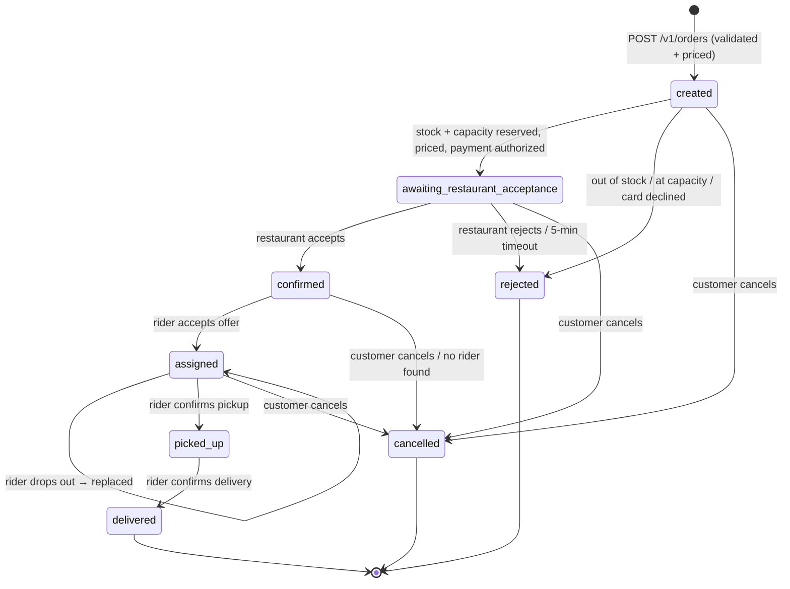

# SmartFoodOps — Technical Documentation (Part A)

This document covers the service breakdown, the order and delivery lifecycles, the
event-driven design, failure handling, and data consistency, followed by the *why* behind
the decisions in [architecture.md](./architecture.md): key tradeoffs, rejected
alternatives, and what's implemented vs. explicitly deferred. Requirements and
traceability are in [PRD.md](./PRD.md); build status is in [PROGRESS.md](./PROGRESS.md).
Everything described here is built (Part A, Weeks 1–3); what's deliberately left out is in
[Production/high-traffic](#productionhigh-traffic-implemented-vs-documented-roadmap) and
[Assumptions](#assumptions).

## Why microservices, not a modular monolith

Company requirement: true microservices, production-oriented, able to demonstrate handling
high traffic — not a monolith with internal module boundaries. Each of the 9 services (the
gateway plus eight domain services) is independently deployable with its own datastore, so no service's failure or scaling need is coupled to
another's.

## Service breakdown

| Service | Responsibility | Key Week 1 endpoints (all under `/v1`) | Added later |
|---|---|---|---|
| `api-gateway` | Single entry point: routing, JWT fast-fail, deny-list, rate limiting, CORS, Swagger index, SSE streaming proxy | proxies everything below; `/docs` | — |
| `user-service` | Accounts, roles, auth tokens, saved addresses | `auth/register`, `auth/login`, `auth/refresh`, `auth/logout`, `users/me`, `users/me/addresses`, `users` + `users/{id}` (admin search), `users/{id}/block`, `users/{id}/unblock` | — |
| `restaurant-service` | Restaurant onboarding + approval, menus, categories, availability, promotions; stock + capacity reservation | `restaurants` (CRUD, `mine`, `admin`, `approve`, `suspend`, `status-history`), `.../menu`, `.../menu/categories`, `.../menu/items`, `.../promotions`; saga activities | — |
| `order-service` | Order creation, pricing, history, state machine; the order saga and refund workflows | `POST orders` (Idempotency-Key), `GET orders`, `GET orders/{id}`, `GET orders/admin`, `GET orders/restaurant/{id}`, `orders/{id}/restaurant-response`, `orders/{id}/cancel`, `orders/{id}/refund` | — |
| `delivery-service` | Riders, vetting, location; deliveries, rider offers, reassignment, ETA | `riders`, `riders/me`, `riders/me/status`, `riders/me/location`, `riders/me/offer`, `riders/me/deliveries/{id}/accept\|decline\|drop-out\|picked-up\|delivered`, `deliveries/by-order/{id}`, `riders/admin`, `approve`, `suspend`, `verification-history` | — |
| `payment-service` | Simulated card payments: authorize, capture, void, refund | `GET payments/by-order/{id}`; saga activities | — |
| `tracking-service` | Live SSE feeds for customers, restaurants and riders | `tracking/orders/{id}`, `tracking/restaurants/{id}`, `tracking/riders/me` | — |
| `notification-service` | Customer/restaurant/rider notifications: in-app, simulated email and SMS | `GET notifications` (mine) | `POST notifications/{id}/read`; Kafka consumer; `notification-worker` (Celery) sends (W3) |
| `analytics-service` | The nine Part A metrics, from events | — | `analytics/summary`, `analytics/restaurants/{id}`, `analytics/peak-hours` (W3) |

Background processes run from the same images: `order-worker`, `payment-worker` and
`delivery-worker` relay their service's outbox to Kafka, and `notification-worker` sends
notifications — each a Celery worker with its own beat schedule
([Event-driven design](#event-driven-design-temporal-kafka-and-celery)).

The live, authoritative endpoint list is each service's OpenAPI page, indexed at
`http://localhost:8080/docs`.

## Order lifecycle

**States**: `created → awaiting_restaurant_acceptance → confirmed → assigned → picked_up →
delivered`, plus the terminal states `rejected` and `cancelled`. `order-service` is the only
writer of `orders.status`, and only the saga (through the `transition_order` activity)
changes it after creation. Every transition appends an `order_status_history` row (actor,
reason, timestamp) and an outbox event in the same transaction, and goes through the
`version` optimistic lock; a repeated transition (an activity retry) is a no-op.

| Transition | Trigger | Side effects |
|---|---|---|
| → `created` | `POST /v1/orders` | server-side price lookup from `restaurant-service` (one quote call); restaurant `active` and accepting orders; items on its menu, available, in stock; drop-off within `MAX_DELIVERY_KM`; `OrderPlaced` outbox row; saga started |
| `created` → `awaiting_restaurant_acceptance` | saga | reserve stock + capacity (atomic), redeem promotion, tax + delivery fee, authorize payment; the restaurant's live feed gets `new_order` |
| `created` → `rejected` | saga | a business failure (`out_of_stock`, `restaurant_at_capacity`, `restaurant_unavailable`, `promotion_invalid`, `payment_declined`), or `system_error` once retries run out; whatever was done is undone |
| → `confirmed` / `rejected` | `POST /v1/orders/{id}/restaurant-response` → signal; or no answer in 5 min (`restaurant_timeout`) | on reject: void payment, release promotion and stock (`restaurant_rejected[: reason]`) |
| `confirmed` → `assigned` | rider accepts an offer ([Delivery orchestration](#delivery-orchestration)) | delivery `assigned`, ETAs, `RiderAssigned` |
| `assigned` → `picked_up` | rider `POST …/picked-up` → signal | kitchen capacity freed (`complete_reservation`); no more cancelling |
| `picked_up` → `delivered` | rider `POST …/delivered` → signal | payment captured (final settlement), rider back to `available` |
| → `cancelled` | customer or system admin cancel (signal) before pickup; or no rider found (`no_rider_available`) | compensation depends on how far the order got ([Failure handling](#failure-handling)) |
| (stays `delivered`) | `POST /v1/orders/{id}/refund` (system admin) | `OrderRefundWorkflow`: payment refund, `orders.refunded_amount` |

Every order event is visible three ways: `GET /v1/orders/{id}` (with `status_history`),
the live SSE feed, and Kafka (from the outbox — what notifications and analytics read).

## Delivery orchestration

1. **Create delivery**: once `confirmed`, the saga creates the `deliveries` row —
   idempotent on `deliveries.order_id` (unique). Pickup (the restaurant) and dropoff are
   snapshotted; `ready_at` = now + the restaurant's `avg_prep_time_minutes`.
2. **Find the nearest rider**: `GEOSEARCH` on the Redis GEO set `riders:available`
   (riders who are approved, on shift, and pinged recently), within 5 km, nearest first,
   skipping riders already tried for this delivery.
3. **Claim and offer**: the candidate is claimed with one atomic
   `UPDATE riders SET status = 'busy' WHERE id = :id AND status = 'available' AND
   verification_status = 'approved'` — if another delivery got there first, the next
   candidate is tried, so two deliveries can never get the same rider. The offer is pushed
   on the rider's live feed (`GET /v1/tracking/riders/me`); the app then reads it from
   `GET /v1/riders/me/offer`, and the rider has 60s to accept or decline.
4. **Reassignment**: a decline, an expired offer, or a drop-out after accepting (the rider
   says so, or sends no location ping for 3 min) releases the rider, increments
   `reassignment_count`, and offers the next-nearest rider. A rider is offered a given
   order only once. While nobody is free the saga looks again every 30s; after 5 offers
   or 10 min it gives up: the order is `cancelled` (`no_rider_available`) and the payment
   voided. A dropped rider is set `offline`. After pickup a drop-out is not reassigned —
   the food is with the rider, so it's a support case.
5. **ETA**: pickup ETA = the later of the rider reaching the restaurant and the food being
   ready (`ready_at`); dropoff ETA = pickup ETA + restaurant → dropoff travel time. Travel
   time = straight-line distance × 1.3 (road factor) ÷ an average speed per vehicle (bike
   12, scooter 25, car 30 km/h).
6. **Pickup and delivery**: the rider marks the delivery picked up, then delivered. The
   endpoints only check ownership and state and signal the saga; the saga changes the
   status, so a rider's update can't race a cancellation. Each change writes a
   `delivery_status_history` row and a `DeliveryStatusUpdated` outbox row, which pushes
   it to the customer's and the rider's live feeds (through Kafka). `delivered` triggers payment capture and returns the
   rider to `available`.
7. **Tracking**: location pings continue during delivery and reach the customer within a
   second (see [Real-time tracking](#real-time-tracking-why-ingestion-and-fan-out-use-different-transports)).

Delivery states: `pending_assignment → offered → assigned → picked_up → delivered`, back to
`pending_assignment` on decline/expiry/drop-out, and `cancelled` before pickup.

## Event-driven design: Temporal, Kafka and Celery

Each tool has one job, so no workflow is split ambiguously between two of them:

| Tool | Owns | Example | Why this tool |
|---|---|---|---|
| **Temporal** | Multi-step control flow that must finish or compensate | the order saga; restaurant accept/reject wait; rider offer timeouts | durable state, retries, timers and signals built in; compensation is ordinary code |
| **Kafka + Schema Registry** | Facts other services react to, decoupled from the flow that produced them | `OrderPlaced` → notifications, analytics | replayable log, per-aggregate ordering (partition key = aggregate ID), many independent consumers |
| **Celery + RabbitMQ** | Short, single-service background jobs | the outbox relay (every second), sending one notification | simple task retries and schedules; no need for Temporal's durability for a one-shot job |

### Events and topics

Twelve event types (`libs/events/src/sfo_events/schemas.py`), one topic per aggregate,
3 partitions each, 7-day retention, plus a `.dlq` twin per topic (created by the one-shot
`kafka-init` container):

| Topic | Events | Written by |
|---|---|---|
| `order-events` | `OrderPlaced`, `OrderAwaitingRestaurant`, `OrderConfirmed`, `OrderRejected`, `OrderCancelled`, `RiderAssigned`, `OrderPickedUp`, `OrderDelivered` | order-service (creation; every saga transition) |
| `payment-events` | `PaymentSuccessful`, `RefundProcessed` | payment-service activities |
| `delivery-events` | `DeliveryStatusUpdated`, `DeliveryEtaUpdated`, `RiderShiftChanged` | delivery-service (every delivery status, creation included; new ETAs; a rider going on or off shift) |

Every event has the same envelope — `event_id` (UUIDv7, the dedup key), `event_type`,
`aggregate_id` (the partition key), `occurred_at` (the outbox row's `created_at`),
`correlation_id` (the request ID) — and a typed payload (Pydantic, `payloads.py`).
Payloads carry what consumers need, so no consumer calls another service: order events
include `customer_id`, `restaurant_admin_id`, `total_amount` and the reason; delivery
events include `rider_user_id` and `customer_id`.

Two events were added for Week 3's consumers. `OrderAwaitingRestaurant` is what tells
the restaurant about a new order: `OrderPlaced` fires before stock and payment are
checked, so the restaurant would hear about orders that then fail. `RiderShiftChanged`
(only offline ↔ on shift, not the saga's busy/available flips) gives analytics the time
on shift that rider utilization needs.

**Schemas**: the JSON Schema of each payload is generated from its Pydantic model and
registered in Schema Registry (`TopicRecordNameStrategy`, so a topic can carry several
event types) with `BACKWARD` compatibility, so a breaking change is refused at
registration. A snapshot of every schema is checked into `libs/events/schemas/`, and a
test fails if a model change would break compatibility with it. Payloads are also
validated when the outbox row is written, so a bad payload fails the business
transaction instead of reaching Kafka.

### Path of an event

1. **Outbox write.** The business change and its `outbox_events` row commit in one
   transaction (no dual write). The row also stores the W3C `traceparent` of the request
   that wrote it.
2. **Relay** (`sfo_events.relay`, Celery beat every 1s in `order-worker`,
   `payment-worker`, `delivery-worker`). In one transaction: take
   `pg_try_advisory_xact_lock` (one relay per service, even with several worker
   replicas — a tick that can't get it does nothing), read up to 200 undispatched rows
   oldest first, produce them (idempotent producer, `acks=all`, key = `aggregate_id`),
   `flush()`, then set `dispatched_at` on the acknowledged rows. A row Kafka refused gets
   `publish_attempts + 1` and `last_error` and is retried next tick; later rows of the
   same aggregate wait behind it, so they can't overtake it. Dispatched rows are purged
   after 7 days (hourly task).
3. **Consumers** (`sfo_events.consumer.ConsumerLoop`): poll → deserialize → process →
   commit the offset. Two consumer groups read all three topics: `notification-service`
   and `analytics-service`. A third, `tracking-service`, reads `order-events` and
   `delivery-events` to drive the live feeds.

Delivery is at-least-once (a crash after Kafka acknowledged but before the relay's
commit re-publishes those rows), so consumers dedupe:

- **notification-service** writes its notification rows and a `processed_events
  (event_id)` row in one transaction (`sfo_events.idempotency.idempotent`); a
  redelivered event finds the row and does nothing.
- **analytics-service** needs no such table: every write is an idempotent upsert
  (`$min` for "first time" timestamps, `$set`, `$max`, `$addToSet`), so applying an
  event twice leaves the document the same.
- **tracking-service** needs none either: an order event is applied only if it moves the
  order forward, so a redelivered (or older) event changes and publishes nothing.

**Consumer failures** (W3-D5):

| What went wrong | What happens |
|---|---|
| The handler raised | retried 3 times in-process (0.5s doubling), then the message goes to `<topic>.dlq` with error headers, the offset is committed, and the partition moves on |
| The bytes don't deserialize or validate | straight to the DLQ (retrying can't fix it) |
| An event type this consumer doesn't know (a newer producer) | skipped and committed |
| An outage — Postgres, Schema Registry or the network unreachable | **not** dead-lettered: nothing is committed, the consumer rewinds to the message and retries with backoff (capped at 30s) until the dependency is back |
| The DLQ publish or the offset commit failed | the same rewind — the message is redelivered, never lost |

The outage rule matters: without it, every event during a database restart would land
in the DLQ. analytics-service also reads the `.dlq` topics (as raw bytes) and records
each dead letter, which is the "failed events" metric.

Consumers run inside their service's API process by default (`KAFKA_CONSUMER_MODE=
embedded`, started from the lifespan; the blocking poll runs in a thread) or as their
own process (`standalone`: `python -m app.consumer`) — the same switch Week 2 uses for
Temporal workers.

### Notifications

`notification-service` turns events into messages (`app/templates.py`), each in-app
and, where someone must act or would want a record, by email or SMS:

| Event | Who is told |
|---|---|
| `OrderPlaced` | customer (in-app, email) |
| `OrderAwaitingRestaurant` | restaurant admin: new order to accept (in-app, SMS) |
| `OrderConfirmed`, `RiderAssigned` | customer (in-app) |
| `OrderRejected` | customer, with wording by reason (in-app, email) |
| `OrderPickedUp` | customer (in-app, SMS) |
| `OrderDelivered` | customer (in-app, email), restaurant admin (in-app) |
| `OrderCancelled` | customer (in-app, email); restaurant admin if it had seen the order (in-app, SMS) |
| `RefundProcessed` | customer (in-app, email) |
| `DeliveryStatusUpdated` | rider: `offered` (in-app, SMS), `assigned` (in-app), `cancelled` (in-app, SMS) |

One row per recipient and channel is written `pending` (with `processed_events`, in one
transaction); after the commit, one Celery task per row is enqueued on RabbitMQ.
`notification-worker` sends it: in-app needs nothing, email and SMS go through a
simulated provider that fails a configurable share of sends (`NOTIFY_FAKE_FAILURE_RATE`,
0.1), so the retry path is real. A failed send is retried with exponential backoff (2s,
4s, 8s, 16s, ±20% jitter); after 5 attempts the row is `failed`. Attempts are counted
in the row, under a `SELECT … FOR UPDATE SKIP LOCKED`, so a duplicate task can't send
twice at once. Tasks are acknowledged late and rejected if the worker dies, so a killed
worker's tasks go back to the queue. A sweep every 30s re-enqueues rows still `pending`
after 60s — that covers a crash between the commit and the enqueue, or a lost task.

### Analytics

`analytics-service` keeps a read model in MongoDB (`analytics` database), built only
from events: one `order_facts` document per order (when it was placed, sent to the
restaurant, confirmed/rejected/cancelled and why, picked up, delivered; its restaurant,
amount and refunds; the current delivery's rider, when they accepted and when it ended,
and reassignments), `rider_shift_facts` (one document per rider going on or off shift)
and `failed_events` (one per dead letter). The nine metrics are computed at read
time with aggregation pipelines over a time window (default: the last 7 days):

| Metric | Definition |
|---|---|
| Total orders | orders placed in the window |
| Orders per restaurant | the same, grouped by restaurant |
| Peak-hour load | orders per hour of day, in `ANALYTICS_TIMEZONE` (Asia/Karachi) |
| Average delivery time | placed → delivered |
| Rider utilization | time on deliveries ÷ time on shift |
| Cancellation rate | cancelled ÷ placed |
| Restaurant acceptance rate | confirmed ÷ (confirmed + rejected by the restaurant or timed out there) — `out_of_stock`, `payment_declined` and the like never reach the restaurant, so they don't count against it |
| Delivery success rate | delivered ÷ deliveries a rider accepted |
| Failed events | dead-lettered messages + sagas that ended `system_error` |

Endpoints: `GET /v1/analytics/summary` and `/peak-hours` (system admin),
`/restaurants/{id}` (system admin or that restaurant's admin). Notification sends that
ended `failed` aren't in this API — they live only in notification-service — but are on
the Grafana dashboards. The consumer also updates Prometheus business counters (orders
placed, outcomes by reason, restaurant responses, delivery duration, shift changes, dead
letters) the first time an event changes a document, so a replay doesn't double-count
them.

## Failure handling

**Retries**
- Saga activities retry 5 times with exponential backoff (1s, doubling). Business failures
  — out of stock, card declined, restaurant at capacity, invalid promotion — are
  non-retryable: they go straight to compensation, since retrying can't change the answer.
  If an activity still fails after 5 attempts the order ends `rejected` (`system_error`)
  with everything undone.
- Compensations, and every step after pickup (capture, final transitions), retry until
  they succeed: the food is already out, so the only acceptable outcome is completing.
- Celery notification sends retry with exponential backoff, 5 attempts. Kafka consumers
  retry a failing handler 3 times and then dead-letter the message; an outage is waited
  out instead ([Event-driven design](#event-driven-design-temporal-kafka-and-celery)). The
  outbox relay retries a row Kafka refused every second until it goes through.
- The one sync call at order creation (order → restaurant quote) has a 5s timeout and
  fails with a clean 503. It doesn't retry: the client holds an `Idempotency-Key` and can
  safely retry itself.
- Temporal itself being down: order creation still returns 201, and a reconciler starts
  the saga for any `created` order aged 60s–1h once Temporal is back.

**Idempotency**
| Operation | Mechanism |
|---|---|
| Create order | `Idempotency-Key` header, unique per customer, plus a request-body hash. Same key + same body → the original order (200); same key + different body → 409; a concurrent duplicate → caught by the unique constraint and replayed |
| Start the saga | workflow ID `order-{id}` — a second start (replay, reconciler) is a no-op |
| Reserve / release stock, redeem / release promotion | one `stock_reservations` / `promotion_redemptions` row per order. A release that arrives before its reserve leaves a `released` placeholder, so the late reserve does nothing |
| Payment ops | one payment per order (`idempotency_key` = order ID); a retried authorize/capture/void returns the prior result; refunds keyed by refund workflow ID. A void before any authorize leaves a `voided` placeholder |
| Create delivery | `deliveries.order_id` unique |
| Status changes | a repeated transition is a no-op; the `version` optimistic lock rejects stale writes |
| Publish an event | the relay may re-publish after a crash; every event keeps its `event_id` |
| Consume an event | notification-service: `processed_events` keyed by `event_id`, in the same transaction as the notification rows. analytics-service: idempotent Mongo upserts |
| Send a notification | the row's status is checked and updated under a row lock; a duplicate task finds it `sent` and does nothing |

**Compensation** (the saga). Each forward step registers its compensation *before* it
runs — safe because every compensation is idempotent and tolerates "never happened" — and
on failure or cancellation they run in reverse order:

| Failed or cancelled at | Release stock + capacity | Release promotion | Payment | Delivery / rider | Order ends |
|---|---|---|---|---|---|
| `created` (a step failed, or cancel) | if reserved | if redeemed | void, if authorized | — | `rejected` (failure) / `cancelled` |
| `awaiting_restaurant_acceptance` (reject, timeout, cancel) | ✓ | ✓ | void | — | `rejected` / `cancelled` |
| `confirmed` (cancel, no rider) | ✓ | ✓ | void | delivery cancelled; an offered rider is freed | `cancelled` |
| `assigned` (cancel) | ✓ | ✓ | void | delivery cancelled; rider back to `available` | `cancelled` |
| `picked_up` onwards | not cancellable (409) — the food is out; a problem becomes a refund after delivery | | | | |

Payment is only *captured* at delivery, so every cancellation before then is a void, never
a refund. Each outcome writes its outbox event (`OrderRejected`, `OrderCancelled`, …),
from which notification-service tells the customer, restaurant and rider.

**Signals that cross**: signals are applied in arrival order. A pickup that arrives just
before a cancel wins (the order is delivered); a cancel that arrives first wins (the
pickup is ignored). A late answer from a rider whose offer already expired is ignored
(signals carry the rider ID).

**Partial-failure guarantees**: order creation validates everything *before* writing, and
writes the order, its items, its history row and its outbox row in one transaction. After
that, the saga guarantees each order ends in exactly one terminal state with every
resource either used or released — verified by the lifecycle scenarios (stock, capacity,
payment and rider all checked after each one).

## Data consistency across services

- **Within a service: strong.** Each service's Postgres is ACID. A state change, its audit
  row and its outbox row commit together.
- **Across services: eventual, coordinated by the saga.** No distributed transactions and
  no 2PC. Each step commits locally, and Temporal guarantees the saga either completes or
  runs its compensations.
- **One owner per fact.** Order status → `order-service`. Price, availability, stock →
  `restaurant-service`. Rider state → `delivery-service`. Money → `payment-service`. Other
  services hold opaque IDs or snapshots, never a second writable copy.
- **Snapshots, not live references.** Order items record the price and name at order time,
  and orders record the delivery address. History stays correct after menus or addresses
  change.
- **No dual writes.** Events are published from the outbox, never "write DB then publish" in
  request code, so a crash can't leave a committed change without its event.
- **Only the saga moves an order or delivery forward.** Endpoints for restaurant, rider
  and customer actions validate and send a signal; the saga applies them one at a time, so
  a pickup and a cancellation can't both win.
- **Atomic conditional updates for shared counters.** Stock, capacity, promotion uses and
  rider claims are single `UPDATE … WHERE <still available>` statements, not
  read-then-write, so concurrent orders can't oversell or double-assign.
- **Optimistic locking** (`version` columns on orders, menu items, deliveries) catches any
  remaining concurrent writers.
- **MongoDB and Redis are never authoritative.** Mongo holds rider location history and
  the analytics read model (rebuildable by replaying the topics). Redis holds live positions, the rider pool and the tracking
  state — all rebuilt from pings, status changes or Postgres. Losing either degrades
  tracking, not correctness.

## Observability

Three signals, all tied together by the trace ID. Everything runs in Compose; the UIs
are on localhost only (URLs in the [README](../README.md#observability)).

| Signal | Produced by | Stored in | Looked at in |
|---|---|---|---|
| Logs | every process: one JSON line per event on stdout (`timestamp`, `level`, `service`, `logger`, `message`, `request_id`, `trace_id`, `span_id`) | Loki — Grafana Alloy tails every container's Docker log; `service` and `level` are labels, `trace_id` is structured metadata | Grafana → *Logs* dashboard, or Explore |
| Traces | OpenTelemetry SDK in every process, OTLP/HTTP | Jaeger v2 (in memory) | Jaeger UI, or Grafana (Jaeger data source) |
| Metrics | `prometheus-client` in every process, on internal port 9100 (Temporal SDK: 9101) | Prometheus, scraped every 15s, 7-day retention | Grafana dashboards; Prometheus *Alerts* |

Grafana links them: a log line's `trace_id` opens the trace in Jaeger, and a span opens
its logs in Loki.

**Logs.** The `X-Request-ID` the gateway assigns stays as `request_id` (one HTTP
request and the calls it makes); `trace_id`/`span_id` come from the active OTel span, so
background work that no request started — a relay publish, a consumer handling an
event, a Celery send — is still findable. Passwords, tokens and card details are
redacted before a line is written (`libs/observability`).

**Traces: one order is one trace.** The trace context crosses every hop:

| Hop | How |
|---|---|
| HTTP (gateway → services, service → service) | FastAPI and httpx instrumentation; httpx adds the `traceparent` header |
| Temporal (API → saga → activities in four services) | `TracingInterceptor` on every client and worker (`sfo_common.temporal`) |
| Outbox → Kafka | the outbox row stores the writer's `traceparent`; the relay's `publish` span continues it and puts it in the message headers |
| Kafka → consumer | the consumer's `process` span continues the trace from the headers |
| Consumer → Celery send | the Celery instrumentation carries the context in the task message |

Database (SQLAlchemy), Redis and MongoDB calls are child spans. Health probes, metrics
scrapes, the relay's every-second poll and long SSE streams are not traced — otherwise
every container would start a trace every few seconds and bury the real ones. Measured:
one delivered order is a single trace across 11 services (gateway, order-, restaurant-,
payment-, delivery-, notification-, analytics-service, the three relay workers and
`notification-worker`). Sampling is 100% in dev (`OTEL_TRACES_SAMPLER_ARG`).

**Metrics.** Served on an internal port, never through the gateway:

| Family | Metrics |
|---|---|
| HTTP (every API) | `http_requests_total{method, route, status}`, `http_request_duration_seconds` — by route *template* (`/v1/orders/{order_id}`), so IDs can't create a series each |
| Outbox (relay workers) | `outbox_backlog`, `outbox_oldest_age_seconds`, `outbox_published_total`, `outbox_publish_failures_total` |
| Consumers | `kafka_events_consumed_total{group, topic, outcome}` (processed / skipped / dead_lettered), `kafka_events_duplicates_total{group}`, `kafka_event_retries_total{group, topic, kind}` (handler / outage), `kafka_consumer_lag{group, topic, partition}` (from committed offsets) |
| Celery | `celery_tasks_total{task, outcome}`, `celery_task_duration_seconds` |
| Business | `saga_outcomes_total{status, reason}` (order-service), `notification_sends_total{channel, result}`, `riders{status}`, `tracking_active_streams{feed}`, and from analytics: `orders_placed_total`, `order_outcomes_total`, `restaurant_responses_total`, `delivery_duration_seconds`, `rider_shift_changes_total`, `dead_lettered_events_total` |
| Infrastructure | Temporal SDK (per worker) and server, RabbitMQ (built-in plugin), Prometheus itself |

Four dashboards are provisioned from JSON (generated by
`infra/grafana/build_dashboards.py`): **Service overview** (requests, 5xx ratio, p95
latency per service, slowest routes, targets up, firing alerts), **Orders & deliveries**
(orders, outcomes, acceptance, delivery time, saga outcomes, rider pool, live streams),
**Event pipeline** (outbox age and backlog, consumer outcomes, duplicates, lag and
retries, dead letters, Celery tasks, notification sends, RabbitMQ queue depth, Temporal
activity failures and latency) and **Logs**.

**Alerts** (`infra/prometheus/rules.yml`; shown in Prometheus and on the Service
overview dashboard — routing them to people is out of scope):

| Alert | Fires when |
|---|---|
| `OutboxLagging` | a service's oldest unpublished event is over 30s old for 1 min (Kafka or the relay is down) |
| `EventsDeadLettered` | any message was dead-lettered in the last 5 min |
| `ConsumerLagging` | a consumer group is over 100 messages behind for 5 min |
| `HighErrorRate` | over 1% of a service's requests are 5xx for 5 min |
| `SagaSystemErrors` | any order ended `system_error` in the last 15 min |
| `NotificationsFailing` | any email/SMS ended `failed` in the last 15 min |
| `TargetDown` | a process hasn't served metrics for 2 min |

The counters these alerts watch are created at 0 when each process starts: a series
that first appears at 1 has no increase Prometheus can see, so the first failure would
otherwise go unnoticed (found by the failure drills below).

**Where to look, by flow** (Part A §6):

| Something's wrong with… | Start at |
|---|---|
| Ordering | Service overview (order-service 5xx/latency) → Orders & deliveries (saga outcomes by reason) → the order's trace |
| Payment | saga outcomes `payment_declined` vs `system_error`; Temporal activity failures; payment-service spans in the trace |
| Rider assignment | Orders & deliveries (rider pool, `no_rider_available` cancellations); delivery-service logs by `trace_id` |
| Tracking | live tracking streams; tracking-service 5xx |
| Notifications | Event pipeline: notification sends (retry/failed), notification-service consumer lag and dead letters; the row's `last_error` |
| Background jobs | Event pipeline: outbox age/backlog, Celery task outcomes, RabbitMQ depth; `TargetDown` for a dead worker |

### Failure drills (verified 2026-10-15)

Each drill was run against the full Compose stack; the commands are in the
[README](../README.md#failure-drills).

| Drill | Result |
|---|---|
| Kafka stopped, orders placed | Orders kept flowing (the saga doesn't need Kafka); the outbox backlog grew and `OutboxLagging` fired after about 2 min; once Kafka was back the backlog drained in about 6s and every notification arrived, nothing dead-lettered |
| Consumer offsets reset to earliest (759 events replayed) | Notification rows and all three analytics collections byte-identical afterwards; the replay shows as 759 duplicates on the Event pipeline dashboard |
| Poison message written to `order-events` | Both groups dead-lettered it, the partition kept moving, analytics recorded it, `EventsDeadLettered` fired within a minute |
| `notification-worker` killed (SIGKILL) mid-batch | The task it held went back to the queue; after a restart every row ended `sent`, each email/SMS exactly once |
| Fake email/SMS failure rate 50%, then 100% | At 50%, 14 of 30 sends needed retries, all ended `sent`; at 100%, each gave up after exactly 5 attempts over about 30s, in-app unaffected, `NotificationsFailing` fired |

The drills found three bugs, all fixed with tests: a message that wasn't valid Schema
Registry framing was treated as an outage (confluent-kafka's `SerializationError`
subclasses `KafkaException`), which blocked its partition instead of dead-lettering it;
consumer lag was computed from the consumer's position, which is unset after a restart,
so an idle consumer looked a whole log behind; and the alert counters above weren't
created at 0.

## Assumptions

- A single currency (PKR), stored as `Numeric(10,2)` and computed with `Decimal`.
- Payments are simulated. There is no real gateway, and authorize-then-capture is modelled
  explicitly.
- Distances are straight-line (haversine), and ETAs use an average speed per vehicle type.
  There is no routing engine.
- One delivery per order, and one restaurant per order.
- Restaurant capacity is a manual `is_accepting_orders` toggle plus a
  `max_concurrent_orders` cap on orders reserved but not yet picked up, not a full
  opening-hours schedule.
- Riders report location by periodic REST pings every ~5–15s, which is accurate enough for
  assignment and tracking.
- Customers can cancel until pickup, not after.
- **Final settlement = payment capture** on delivery. Splitting the captured amount into
  restaurant payout, rider earnings and platform commission is a separate finance
  system, out of scope for Part A.
- Payment is simulated by method: `card_simulated` approves, `card_simulated_decline`
  declines — deterministic, so the decline path can be demonstrated and tested.
- **One refund per order** (`refund-{order_id}`), full or partial, by a system admin after
  delivery; several partial refunds would need a refund-request ID in the workflow ID.
- **Drop-out after pickup** is a support case, not an automatic reassignment.
- A rider who declined or missed an offer isn't offered that order again, and nothing
  takes a rider off shift for repeatedly ignoring offers (both possible later
  improvements).
- Deliveries are limited to 15 km straight line from the restaurant (`MAX_DELIVERY_KM`);
  the delivery fee is 100 PKR + 30 PKR/km; tax 5%.
- Riders don't manage routes in-app beyond seeing pickup and dropoff coordinates.
- Email and SMS are simulated (a log line); a configurable share of sends fails, so the
  retry path runs. The in-app inbox (`GET /v1/notifications`) is the only channel a user
  can read back.
- Analytics are eventually consistent: a few seconds behind the orders they describe.
  Windows default to the last 7 days, and hours of the day are counted in Asia/Karachi
  time.

## Gateway: single entry point, not a SPOF

A single `api-gateway` instance would mean every client request depends on one container.
Since JWT verification needs no server-side session and rate-limit counters already live in
Redis (not gateway memory), the gateway is designed to be safe to run as multiple stateless
replicas — nothing about its own state prevents it.

**Where that HA is actually implemented vs. just enabled**: in a real deployment, this
means a Kubernetes `Deployment` (N replicas, or an `HorizontalPodAutoscaler` reacting to
load) behind a `Service`, which load-balances across whatever pods currently exist and
drops ones that fail their readiness probe — no extra component needed, since this is
what Kubernetes `Service`s already do natively.

**Originally built locally with Traefik, then removed.** The first version of this repo
ran `api-gateway` as multiple Docker Compose replicas behind Traefik (auto-discovering
replicas via Docker labels, round-robining, polling `/health`), specifically to have
something to point at for "no SPOF." Two things killed that: (1) Docker Desktop's
Enhanced Container Isolation blocks exactly the kind of Docker-socket access
Traefik's auto-discovery needs, which is a Docker-Desktop-only issue that would never
occur against a real Linux Docker Engine or Kubernetes — but more fundamentally, (2) three
containers on one laptop don't actually exercise the failure mode HA is for. A real
instance dying and traffic rerouting around it is a multi-host phenomenon; simulating it
with `docker compose --scale` on a single machine doesn't prove anything true about
production behavior, it just adds a component (and, as it turned out, a source of local
environment breakage) for a demo that wasn't demonstrating anything real. `api-gateway`
now runs as a single container locally, exposed directly — the HA design is documented
here as the production (Kubernetes) plan, not something faked locally for its own sake.

## Inter-service communication: REST over gRPC

**Decision**: synchronous inter-service calls use REST/JSON over async `httpx`, not gRPC.
As built there are few of them: the quote at order creation (order → restaurant) and
`tracking-service`'s fallbacks. The saga's steps don't call other services' APIs at all —
each runs as a Temporal activity inside the service that owns the data, reached through
its task queue, with Temporal's pydantic converter carrying the same Pydantic models.

**Why REST was chosen**: gRPC's latency/throughput benefit (binary protobuf, HTTP/2
multiplexing) isn't observable running on local Docker Compose for a mentor demo — there's
no real production-scale QPS here to benefit from it. Meanwhile it costs real engineering
time on a 3-week solo build: `.proto` schemas + codegen tooling, `restaurant-service`/
`payment-service`/`delivery-service` each running two server protocols (REST for
client-facing reads, gRPC for internal saga calls), and — the biggest ongoing cost —
protobuf messages don't interoperate with the Pydantic models used everywhere else, so
every gRPC boundary needs hand-written conversion glue permanently, not just at setup.
Python's gRPC support itself is mature (`grpc.aio` is asyncio-native, fits the async stack
fine) — the cost is the protobuf/Pydantic mismatch, not gRPC-in-Python maturity.

**Roadmap**: the hot cross-service path (the saga) already avoids REST, so gRPC would
only matter for the order-creation quote. If that call ever became a bottleneck at real
production QPS, it is the specific place to swap REST for gRPC — documented here so the
tradeoff is visible, not revisited from scratch later.

## Why both Temporal and Kafka (not just one)

Temporal owns the order saga's *control flow* — steps that must happen in order, with
compensation if any step fails (payment authorized but restaurant rejects → refund; rider
assignment fails → retry/reassign). This needs a "did this succeed, yes/no, right now"
answer to proceed, which fits Temporal's activity model, not an async event.

Kafka owns *decoupled fan-out* — facts that other services react to without being part of
the saga's control flow (`notification-service`, `analytics-service`). If notifications
were a synchronous saga step, a notification outage would block order confirmation, which
is wrong — a customer's order shouldn't fail because SMS delivery is down.

**Reliability**: transactional outbox pattern — each producing service writes its event row
in the same DB transaction as its state change, avoiding a dual-write bug without needing a
CDC tool like Debezium. A Celery-beat periodic task per service polls the outbox and
publishes to Kafka, marking rows dispatched.

## Restaurant accept/reject: a Temporal signal-with-timeout

The Guidelines explicitly call for a restaurant order acceptance/rejection flow, not just
automatic confirmation after payment. This is a natural fit for Temporal's signal+timeout
primitive: once payment is authorized the order moves to `awaiting_restaurant_acceptance`,
the restaurant's live feed gets `new_order`, and the saga waits for an accept/reject
signal (from `POST /v1/orders/{id}/restaurant-response`) for up to 5 minutes. No answer in
time auto-rejects (`restaurant_timeout`) — the same compensation path as an explicit
rejection or a cancellation. Restaurant ownership is snapshotted onto the order, so
order-service authorizes the response without asking restaurant-service.

## ORM: SQLAlchemy 2.0 async, not SQLModel

SQLModel merges the DB table model and API schema into one class, but that breaks down once
a service needs to hide internal columns (`version`, `hashed_password`, audit fields) from
its API response — separate Pydantic input/output schemas end up being written anyway, on
top of SQLModel's wrapper. It also doesn't cleanly expose SQLAlchemy's `version_id_col`
optimistic-locking mapper config or the raw Core-style queries needed for rider assignment
and outbox polling (`SELECT ... FOR UPDATE SKIP LOCKED`) — both required here — so
`order-service`/`delivery-service`/`payment-service` would drop to plain SQLAlchemy anyway.
Rather than mixing ORM patterns across every service for one engineer to maintain, SQLAlchemy
2.0 async + Alembic is used everywhere.

## Kafka client: confluent-kafka-python, not aiokafka

aiokafka is asyncio-native, which would fit the rest of the async stack. But Kafka
producers and consumers here never sit in a request path: the relay runs in a Celery
worker, and a consumer's blocking `poll` runs in a worker thread, so it doesn't block the
API's event loop — and confluent-kafka-python (the
official librdkafka-backed client) has first-class, well-documented Confluent Schema
Registry integration, which the tech stack explicitly calls for. Chose the stronger Schema
Registry story over the async-native fit, since the latter provides no real benefit here.

## Week 3 tradeoffs

**JSON Schema, not Avro or Protobuf.** All three work with Schema Registry. The payloads
are already Pydantic models, which generate JSON Schema directly, so there's one source
of truth and no second IDL to keep in step; messages stay readable with any Kafka tool.
Cost: larger messages than Avro and slower (de)serialization — irrelevant at this
volume; switching is a serializer change, the contracts stay the same.

**Celery-beat polling relay, not CDC (Debezium).** Debezium would read the Postgres WAL
and add Kafka Connect, a connector per database and replication slots to operate.
Polling every second costs one indexed query per service per second (a partial index
on undispatched rows) and up to ~1s extra latency, which notifications and analytics
don't notice. The outbox table stays the contract either way, so CDC can replace the
relay later without touching the services.

**Advisory lock, not `SELECT … FOR UPDATE SKIP LOCKED`, for the relay.** `SKIP LOCKED`
would let two relays share the work, but they would split one order's events and
publish them out of order. The relay is not the bottleneck (one batch of 200 a second);
per-order ordering is what consumers depend on.

**Consumers embedded in the API process (dev), not their own containers.** Fewer
containers on an 8 GB laptop — the stack already runs 30. The consumer loop is the same
code either way; `KAFKA_CONSUMER_MODE=standalone` runs it as its own process for
production, where it should scale and restart separately from the API.

**No OTel Collector.** Jaeger v2 is itself built on the Collector and accepts OTLP, so
services export straight to it — one container fewer. A Collector (for tail sampling,
or several backends) can be put in front later by changing `OTEL_EXPORTER_OTLP_ENDPOINT`
only.

**Mongo upserts, not transactions, for analytics.** Mongo here is a single node (no
replica set, so no multi-document transactions), and none are needed: every write is
an idempotent upsert of one document, so replays and out-of-order topics are safe
without a `processed_events` table. Metrics are computed at read time from the facts,
not kept as running totals that a replay would double. Cost: each summary request
aggregates the window's facts — fine for thousands of orders a day; at larger volume,
pre-aggregated hourly rollups would be the next step.

**Prometheus counters next to the Mongo read model.** Grafana gets live business panels
without a Mongo data source plugin, and the API stays the source of exact historical
numbers. The counters only move the first time an event changes a document, so they
don't double on a replay; they do reset when the process restarts, which Prometheus'
`rate()`/`increase()` handle.

**Simulated email/SMS without addresses.** Notifications carry the user ID only. A real
sender would look up the email address or phone number from a user-contact projection
fed by user-service events, which keeps notification-service free of synchronous calls
to other services.

## Auth: 15-minute access tokens, rotating refresh tokens, Redis deny-list

Blocking a user (ban, fraud, etc.) needs to take effect close to instantly, but checking a
DB on every single request just to verify "not blocked" would make `user-service` a hard
synchronous dependency for every request through the gateway — a worse SPOF than the
gateway itself. Instead:

1. Access tokens are short-lived (15 min) stateless JWTs — fast to verify, no DB call.
2. Refresh tokens are **not** stateless JWTs — they're tracked server-side in `user_db`
   (hashed), so they can be explicitly revoked and rotated. Each refresh issues a new
   refresh token and revokes the old one — enables instant logout and theft detection: a
   reused, already-rotated-out refresh token signals compromise, and revokes all of that
   user's refresh tokens. Tradeoff: with no per-device token families, that logs the user
   out everywhere, which is acceptable for a rare, security-relevant event.
3. Blocking writes the user's ID to a Redis deny-list with **TTL = access-token lifetime**.
   The gateway checks this on every request. The TTL is safe specifically because it's
   bounded by the access token's own lifetime: once the Redis entry expires, the
   corresponding access token has also expired, and getting a new one requires `/v1/auth/refresh`,
   which checks `user_db.is_blocked` directly — the authoritative, non-cached check. So the
   deny-list only ever needs to cover the current token's remaining lifetime, not the block
   indefinitely — there's no window where both the cache and the DB have "forgotten" a block.

## Defense-in-depth auth

Docker Compose puts every service on the same network, reachable by hostname from any other
container — trusting the gateway alone to gate access assumes no request can ever bypass
it, which isn't guaranteed (misconfiguration, routing bugs, a compromised container). Every
service re-verifies the JWT independently via the shared `libs/auth` dependency — low
effort (one shared library call), standard zero-trust-internal-network practice.

## Real-time tracking: why ingestion and fan-out use different transports

Riders and customers have different traffic shapes. Rider location pings are
bounded-frequency (~5–15s) and many-to-one — a plain REST `PATCH` keeps `delivery-service`
fully stateless and lets any replica handle any rider's ping, no connection-affinity
bookkeeping. Making rider ingestion a persistent connection would trade a small
HTTP-overhead saving for a much bigger cost: `delivery-service` becoming stateful purely to
hold thousands of open sockets.

Customers and restaurants want push, so they get **Server-Sent Events** from a separate
**`tracking-service`**, fed by **Redis Pub/Sub**:

- **SSE, not WebSocket**: the traffic is one-way (server → client). SSE is plain HTTP, so
  it passes through the gateway, auth and proxies unchanged, and browsers reconnect
  automatically.
- **A separate service**: long-lived connections are a different load from short REST
  requests. Keeping them in their own small, stateless service (no database, Redis only)
  means they scale on their own and can't exhaust the connection pools of the services
  that do the real work. The gateway relays the stream from its own dedicated pool.
- **Kafka for order status, Redis Pub/Sub for the last step.** Order status updates
  come from Kafka: `tracking-service` consumes `order-events` and applies each one. They
  used to be published to Redis by order-service right after its commit, best-effort — a
  Redis blip at that moment lost the update, and the snapshot stayed stale until the next
  change. Through Kafka the consumer waits out a Redis outage and catches up, so an update
  can't be lost; the price is up to about a second of extra delay (the outbox relay runs
  every second). Kafka is *not* used for the last step: a consumer group gives each event
  to one replica, while the customer's stream may be held by another, and having every
  replica read every event grows the work with each replica. So the consumer writes the
  state and `PUBLISH`es, and each tracking replica receives only the channels its own
  clients watch.
- **Missed Pub/Sub messages resync.** Pub/Sub keeps nothing. On (re)connect a client
  first gets a snapshot of the current state; a client that may have missed something —
  too far behind, or its replica's Pub/Sub connection dropped (redis-py reconnects
  silently, so the hub listens for reconnects) — is disconnected so it reconnects for a
  fresh snapshot.
- **Delivery details through Kafka too; positions direct.** Delivery status and ETAs
  (`DeliveryStatusUpdated`, and `DeliveryEtaUpdated` since ETAs are computed without a
  status change) reach the customer's and rider's feeds through the same consumer. Rider
  positions are published by delivery-service itself, best-effort: they arrive every few
  seconds, so storing each one in Kafka would buy nothing.
- **Riders get a push, then fetch.** The rider feed's messages (`offer`, `released`,
  `delivery`) only say that something changed; the app reads the offer or delivery from
  the existing REST endpoints. Offers are rare, so one extra request costs nothing, and
  REST stays the single source of truth — the feed never has to carry or keep in sync
  every offer field. Riders used to poll `GET /v1/riders/me/offer` every 2s, a load that
  grows with the number of online riders rather than with orders; the app now checks
  every 30s as a safety net and on each (re)connect.
- **Ownership from Redis**: the snapshot state includes the order's `customer_id` and the
  restaurant's owner, so `tracking-service` authorizes a stream without calling another
  service; if Redis lost a key, it rebuilds it from an `/internal` endpoint once.

## Primary keys: UUIDv7 generated in Python, not v4, not DB-side

**Decision**: every ID in the system (`sfo_common.new_id()`) is a UUIDv7 (RFC 9562,
time-ordered — the leading bits encode a millisecond timestamp), generated in the
application layer via the `uuid-utils` package, not Postgres's native `uuidv7()`
(available since PG18) and not the old `uuid.uuid4()` (fully random).

**Why v7 over v4**: random v4 keys scatter inserts across a B-tree index in random order,
causing page splits and worse cache locality as write volume grows. v7's time-ordering
keeps inserts mostly appending to the end of the index — better under the sustained write
load this system is meant to demonstrate handling.

**Why generated in Python rather than by Postgres**: the ordering benefit comes from the
UUID *value* itself (the embedded timestamp), not from where it was computed — a
Python-generated v7 ID is exactly as index-friendly as a Postgres-generated one. But not
every ID in this system lives in Postgres: Kafka event IDs (`sfo_events`) and future Mongo
document IDs (`delivery-service` rider pings, `analytics-service`) are generated outside
any Postgres connection, so they need Python-side generation regardless. Generating every
ID the same way — one shared `sfo_common.new_id()` helper — keeps one consistent, sortable
ID scheme across Postgres rows, Kafka events, and Mongo documents, rather than Postgres
rows being v7 while everything else stays v4. It also means the ID is known in memory
before any DB round-trip, which matters for the outbox pattern (the business row and its
outbox row need the same `aggregate_id` in one transaction) and for populating
relationships before commit. Staying on `postgres:16-alpine` (no need to adopt PG18) was a
consequence of this, not the goal itself.

**Note**: the request correlation ID (`sfo_common.middleware`) is deliberately still a
plain `uuid.uuid4()` — it's never a DB key, so there's nothing to gain from making it
sortable.

## Database-per-service: separate containers, not shared instance + logical DBs

Chose separate Postgres containers per service over one Postgres instance with per-service
logical databases. The latter is lighter on local resources, but a single Postgres crash
would then take down all services' data layer at once — undercutting the isolation
deliberately built everywhere else (no cross-service DB access, per-service failure domains). Accepted
tradeoff: heavier local resource usage (~6 Postgres containers), no added engineering cost
(same migrations either way).

## Production/high-traffic: implemented vs. documented roadmap

**Implemented (Week 1)**: fully async I/O stack (FastAPI + asyncpg/SQLAlchemy async + async
httpx); stateless domain services (no in-process session state — any replica can serve any
request); Redis-backed gateway rate limiting; per-query DB indexes on the hot lookup paths
(owner/customer/restaurant IDs, city, cuisine); keyset-paginated lists with matching
`(filter…, created_at, id)` indexes; per-backend connection pools in the gateway (one slow
service can't starve the others) with fail-fast 503 when a pool is full; explicit DB pool
sizing plus Postgres statement/idle-in-transaction timeouts; argon2 off the event loop and
SHA-256 (not argon2) for refresh-token secrets; a single `restaurant-service` call per order,
made without holding a DB connection; advisory-locked migrations so replicas can start
together.

**Implemented (Week 2)**: Temporal activity retry/backoff for every saga step; Temporal
workers that can run as their own processes (`TEMPORAL_WORKER_MODE=standalone`) and scale
separately from the APIs; stock, capacity, promotion and rider claims as single atomic
conditional `UPDATE`s with fixed lock ordering (no overselling, no double-assignment, no
deadlocks — each proven by concurrency tests against real Postgres); rider proximity
search in Redis GEO instead of a table scan, with Postgres location writes throttled to
one per 30s per rider; live tracking in a separate stateless service with one Redis
subscription per watched channel per replica.

**Implemented (Week 3)**: every event published through the outbox with no dual write;
Kafka partitioning by aggregate ID (3 partitions per topic), so a consumer group can scale
to 3 consumers per topic with per-order ordering kept; idempotent consumers, so scaling or
replaying can't double-process; relay and notification workers that run as their own
containers and scale separately from the APIs (the relay's advisory lock keeps it to one
active relay per service, however many replicas); a DLQ per topic, so one bad message
can't stop a partition; per-process Prometheus metrics and alerts on outbox age, consumer
lag, dead letters, 5xx rate, saga system errors and failed notifications. Horizontal
replica scaling of domain services is a deployment concern (Kubernetes `Deployment`s) —
not demonstrated with `--scale` locally, for the same reason given for the gateway
above.

**Documented roadmap, not built** (out of scope for a Docker Compose dev/demo environment,
but service boundaries are drawn so these wouldn't require a redesign later): read
replicas, Kubernetes-native gateway scaling (`Deployment`/`HPA` + `Service` — see
[Gateway: single entry point, not a SPOF](#gateway-single-entry-point-not-a-spof)), gRPC
for the saga's synchronous calls, Alertmanager routing for the alerts, Kafka broker
(JMX) metrics, persistent trace storage (Jaeger runs in memory) and an OTel Collector in
front of it, a consumer for user-service events to give notification-service real email
addresses and phone numbers.

## Library & tooling choices

| Concern | Choice | Why |
|---|---|---|
| ORM | SQLAlchemy 2.0 (async) | See rationale above |
| Migrations | Alembic | Standard SQLAlchemy companion, async-capable env |
| Request/response validation | Pydantic v2 | Ships with FastAPI |
| Config/env loading | pydantic-settings | Typed per-service env config |
| Sync inter-service HTTP | httpx (async) | See REST-vs-gRPC rationale above |
| Retry/backoff | Temporal activity retry policies | The one sync call at order creation (order → restaurant) has a timeout and a clean 503 but no retry; saga activities use Temporal's retry policies rather than a separate `tenacity` layer |
| Workflow orchestration | Temporal (`temporalio` Python SDK), pydantic data converter | Durable timers, signals and retries for the order saga; the pydantic converter keeps `Decimal` and `datetime` exact across activities |
| Password hashing | argon2-cffi (via `pwdlib`) | `passlib` is effectively unmaintained |
| JWT | PyJWT | Simpler, actively maintained vs. `python-jose` |
| Redis client | redis-py (`redis.asyncio`) | Official, async-native since v4.2 |
| MongoDB client | PyMongo `AsyncMongoClient` | Official driver's native async API — replaces Motor, which MongoDB deprecated on 2026-05-14 |
| Gateway rate limiting | In-house (`app/rate_limit.py`, Redis-backed) | `fastapi-limiter`'s `RateLimiter` dependency crashed against this FastAPI version's routing internals (see docs/PROGRESS.md, "Docker verification"). Replaced with ~40 lines: one atomic Lua `INCR`+`PEXPIRE` per request, keyed by user ID (valid token) or client IP (anonymous) + a caller-supplied bucket name; the script also returns the remaining TTL, so a 429 needs no second round-trip. Needs shared state across gateway replicas either way, which Redis still provides. |
| Kafka client | confluent-kafka-python 2.x, JSON Schema serializer + Schema Registry client | See rationale above |
| Background jobs | Celery 5 on RabbitMQ (solo pool, beat in the same process) | Retries, countdowns, schedules and late acks with no extra code; the solo pool keeps one event loop + async engine per worker, which our async-only DB layer needs |
| Analytics store | MongoDB (PyMongo async) | Idempotent upserts per order and aggregation pipelines for the metrics; non-authoritative, rebuildable from Kafka |
| Tracing | OpenTelemetry SDK, OTLP/HTTP → Jaeger v2 | Vendor-neutral; instrumentations for FastAPI, httpx, SQLAlchemy, Redis, PyMongo, Celery; Temporal's own interceptor |
| Metrics | prometheus-client, scraped by Prometheus | Plain counters/gauges/histograms per process, no agent |
| Logs | Grafana Alloy → Loki, viewed in Grafana | Tails Docker's JSON logs, no change to the services; `trace_id` links each line to its trace |
| Testing | pytest + pytest-asyncio + httpx.AsyncClient (ASGITransport); Temporal's time-skipping test server | Unit tests everywhere; saga tests run the real workflow with faked activities on a time-skipping server (a 10-minute rider search takes milliseconds); `db`-marked tests run against the compose Postgres/Redis in separate `*_test` databases (`scripts/check.sh --with-db`) — used instead of testcontainers since the stack is already running; `scripts/smoke_test.py --lifecycle` drives whole orders through the gateway |
| Lint/format/types | ruff + mypy | Fast, replaces flake8+isort+black in one tool |
